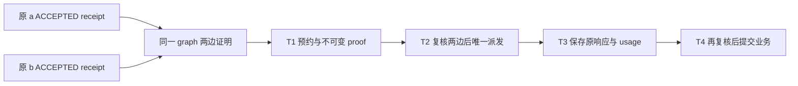

# N5-2 G v1：不可变图、依赖事实与派发证明

状态 **PROPOSED / NOT_IMPLEMENTED / NOT_RUN**。这里的逻辑表名、接口和枚举是具体提案，
不是已存在的 C++／SQL API。建议放入后继 014/412，须协调者采纳且独立审查后实现。

## 已核对的当前事实

在 `451b232a0dde08220a5e096d91209087b027b42e`，`Impl::independent_nodes` 只允许
1..20 个独立 team_task，受冻结 max_teams_per_request 约束，拒绝 depends_on、review、
capability、input。历史 `task_deps` 主键是 (task_id, depends_on)，无 plan_revision。
`workflow_submissions` 保留原 binding/body/artifact_snapshot/record_sha256；原候选状态为
CANDIDATE_READY，业务 ACCEPTED 在 tasks 与 candidate_acceptances，而非新增 submission 枚举。

`Store::accept_candidate` 的 immutable fact 保存**验收前** task_version 和
submission_version；正向事务将两行 state_version 各加 1，并写原 experience job。
candidate_acceptances 的 status/state_version 可变；record_sha256 所覆盖的原事实不可改。
因此既不能要求当前 task CAS 等于验收前 CAS，也不能仅凭旧 status=ACCEPTED 的快照派发 c。

## 图协议及容量

建议新 host 模式 `dag-join-v1`；不向旧 Plan Schema 添加未知字段。模型仍给原 Plan 格式，
可信宿主另固定格式标签、限额和原字节。首片恰好三节点、两条必需边，node_id 可由原 Plan
合法取值，文中 a/b/c 是角色示例。三个节点均 required=true，无 review/capability/input，
无可选边、无自环、无重复边、无跨请求端点；拓扑只接受两个根向一个汇合节点。
原 20 节点上限与更小冻结 team 上限仍同时约束；team 上限小于 3 时拒绝该模式。

建议每请求最多 16 个已发布图版本、64 份派发依赖证明、2 MiB 新增图元数据；包括历史行，
不能靠 checkpoint 删除原事实以重新取得额度。候选内容另沿用原提交 524288 字节序列化上限，
每请求最多 64 个映射；这些是待批准的新模式上限，不能提高既有冻结上限或 settlement reserve。
计算无环、hash、容量全部有界；无 Store 事务内模型等待。

## 建议事实与投影

| 逻辑载体 | 唯一键／不可变 payload | 变化方式 |
| --- | --- | --- |
| dag_graphs_v1 | graph_id；唯一 (request, requirements_revision, plan_revision, format)；原 Plan bytes/hash、规范图 bytes/hash、完整发布 Dispatcher binding、捕获 request CAS、policy/limits hash、原 event link/command | INSERT 一次，UPDATE/DELETE 拒绝；同 command 精确重放只读 |
| dag_nodes_v1 | (graph_id,node_id)；request/task/team、原模板/brief hash、required、完整原 node bytes | 节点版本属于图；不覆盖历史 node，也不靠 tasks 当前行重建旧映射 |
| dag_edges_v1 | (graph_id,from_node,to_node)；required=true、failure_policy=all-required-accepted-v1 | 两端必须外键属于同 graph/request；唯一边与无自环；完整图再做拓扑验证 |
| dag_graph_heads_v1 | request_id → graph_id、state_version、可用/暂停/终态原因 | CAS 投影；Plan/AMEND 事务更新，不改变图事实 |
| dag_node_states_v1 | (graph_id,node_id)；blocked/eligible/active/candidate/accepted 投影、原始原因引用、state_version | 独立投影，绝不向 workflow_submissions 写新枚举；只读 eligible 不授权 |
| dag_acceptance_receipts_v1 | acceptance_id；graph/node/candidate map ID；原验收 fact/hash、原 producer binding；前置 task/submission CAS、事务后 task/submission CAS、acceptance state_version=1；receipt bytes/hash | 在正向验收的同一事务追加；原 S1 验收和 experience job 必须一起提交 |
| dag_dependency_proofs_v1 | proof_id；目标 graph/node、原目标 binding/CAS、attempt/op/link ID、逐边 source receipt ID/hash、**捕获时**源当前 binding/CAS/status、有效原恢复见证链 hash | 在 T1 捕获后一次写定；T2/T4 都检查。旧 proof 永不刷新；新工作要新 proof |
| dag_dependency_rejections_v1 | 原 graph/node、触发来源／版本、原因码、原待办 ID | 同一原因版本去重追加；保留 FAILED/CANCELLED/SUPERSEDED/UNKNOWN/REVOKED 的区别 |

事实的删除触发器应拒绝级联抹除；未来 purge 不是本卡。身份字段绑定原值，内容 hash 从
Store 已验证的原字节构造。writer_session 不进入这些历史 hash；每个有权限的当前调用仍须
通过该 Store 签发会话检查，且该检查在 exact replay 之前。

## 发布、验收与最小接口

`enable_dag(root, frozen_limits, command)` 仅接受在 412 admission barrier 后新建的请求；
旧 410/411 请求拒绝，不能用一张新图修改旧冻结合同。模式启用是宿主控制，不是模型工具。

`apply_join_plan(dispatcher, captured_request_binding, expected_request_cas, original_plan,
node_allocations, command)`：在原 Store mutex／BEGIN IMMEDIATE 中先验证全部节点、边、
模板、brief、目录授权、容量、request CAS 和 actor，再共同提交原 plan/task/team/inbox 与
图事实／head。任何错误（包括后段容量、hash 和 SQLite 故障）整体回滚。旧的独立计划接口
保留原 Unsupported；启用图模式后，普通 publish_plan/create_task 也不能单独改变该图。

`accept_join_candidate(dispatcher, captured, expected_task, submission_id, expected_submission,
decision, graph_id, command)`：复用原验收守卫与原函数事务内实现，再原子附加 candidate map
和 acceptance receipt。通过原 self_check、TL check、完整 criterion、settled、AMEND、终态和
权限检查之后才可 ACCEPTED。要求 review 的节点仍拒绝，直到第二片独立获准。
图请求经普通 accept_candidate 路径必须明确拒绝或走同一内部 guard，不能遗漏 receipt。

`dag_ready_tasks(request)` 只返回有界观察（graph、node、reason、相关原 ID）；不返回可以
直接复用的派发权。`capture_dag_dependencies` 是同一 T1 事务内 helper，非公开免检入口。
`recapture_dag_after_recovery` 是拟议当前 Dispatcher 控制入口，见下文 D2；无此实现时 HOLD。

## T1、T2、T3、T4 的实际检查

T1 的 proof 必须捕获当前 graph/head CAS、原 c task/team/binding、a/b 两份有效 source receipt。
每条 receipt 的原 hash 与 candidate map 原 hash 均复核；当前 acceptance 必须仍为同 ID 的
ACCEPTED，当前源 task 必须 ACCEPTED，原 submission 必须仍是当前语义候选。
首次无额外变更时，当前 task/submission CAS 必须等于 receipt 保存的**验收后** CAS；
不得用 “当前 CAS ≥ 旧 CAS” 推断授权。合法恢复的变化只能用下节明确见证解释。

T2 唯一 claim 事务和 T4 业务提交事务重新读取完整 proof/graph/source receipt/current rows，
逐一比较两边捕获的当前 binding/CAS 与 graph head。任一变更令旧 proof 无效，整笔新业务
回滚，不能替换成最新 acceptance 或只重查 ready 标志。若 T2 已发生，原 callback 可以结束，
T3 保存原 settlement/nullable usage；T4 的 stale/UNKNOWN 拒绝不能吞掉原 response/feedback。
图的准备／失败待办不能让原 T0 claim 中没有选中的 ID 被完成。

新 graph action 在实施前也须按 action 冻结 receipt/map、验收／experience job、feedback、
逐 ID 完成和失败收尾所需的最大编码字节与原 business/control 事件尾部。T1 原子取得这些
预留；T4 在原业务事务内再次核本 link 的原预留、其他未消费预留、实际用量和原冻结限额。
不能直接沿用 N5-1 plan/instruction/note 的尾部计数，不能用图的行数上限证明收尾空间。
不足／归属不明时回滚整笔业务，原 T3 响应与 HOLD 保留；不消耗兄弟请求或控制专用容量。

Store 入口覆盖必须包括模型 reserve/claim、工具 prepare/唯一 dispatch、submit/check/accept、
change/rework 及其直接公开重放入口。仅在 runtime 的 ready 清单过滤不够。图模式的 live
入口首片直接 Unsupported；不能因一般 live API 存在而绕开图边。取消、结算、明确控制 ack、
待办查询和恢复各走原受限控制守卫，不用依赖就绪条件阻止解除阻塞所需的控制操作。
原业务门禁也不能被新 graph guard 代替。

## AMEND、恢复及 D2 的明确选择

AMEND/新 plan/源 task 或 instruction 语义变更、撤销接受均使旧 proof 无效并持久记录原因；
所有 retained task 仍须原 update/keep/cancel 处置。keep 不自动继承新图的依赖权，新 graph
须重新构造全部节点与边映射。UNKNOWN 单独 HOLD，不写失败、不释放未知预算或资源。
终态请求保留图和证据，不再获得新业务权。

推荐 D2 允许**原验收事实继续作为数据来源**，但恢复后必须新建依赖 proof 才能开始新工作：
当前 Dispatcher 明确请求重捕获；Store 验证从原已接受绑定到当前绑定的完整原 recover
事件、原 instruction body hash、同语义 requirements/plan/task/instruction/policy、同原候选
和仍有效 acceptance，且没有 AMEND、撤销、未结算／UNKNOWN 或不明中间变更。当前源 CAS
只允许见证链能够逐项解释的转换；缺少证明拒绝，不能只忽略 epoch 或 state_version。
保存新 proof 对原 receipt 及完整见证的引用，原 proof、Actor、acceptance 不改盖新 epoch。
具体哪些行 CAS 随 recovery 改动须在实现时从现有 recovery 事务生成可核验证据，未证明即 HOLD。
恢复 CAS 转换的完整见证及篡改／缺失／断链负例是 D2 实施前置；未补齐时不得开放重捕获入口。

这不是复用旧审核 verdict：第二片 ticket 要求双方当前捕获身份，任一方 epoch 变更都需新
ticket／新计费 attempt。D2 未获批准时采用保守出口：恢复后的 DAG 不派发，显示
DEPENDENCY_RECAPTURE_REQUIRED；不为了演示强制重作文件或伪造新的验收记录。
