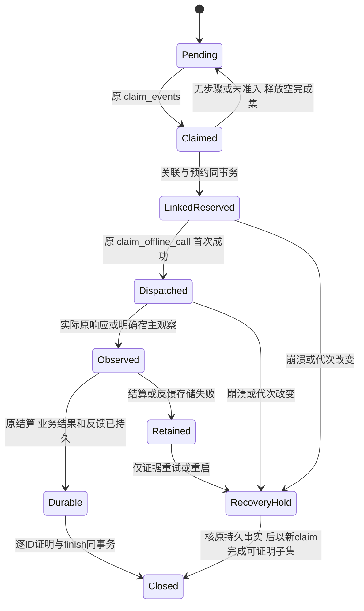

# N4-A：单协调写者的有限异步 inbox 驱动

状态：**拟议设计；未实现、未执行以下验收**。来源、精确基线和授权见[索引](README.md)。
目标是在原持久事件链上重叠有限 FakeModel 等待，使独立请求能推进，并保持每次业务派发、
原账目和实际完成事件可追溯。第一纵向范围是两个请求、各两个独立节点的
plan → instruction → ack → note，以及 ask/wait、部分 AMEND、取消和重启。
文件提交、`fs_*`、`run`、live、后台 daemon、第二 Store 写者均不在该范围。

## 当前公开接口与实际缺口

| 当前路径/符号 | 已有行为 | 接入时不可推导的能力 |
| --- | --- | --- |
| [event_runtime.hpp](../../../include/wls/event_runtime.hpp)：`EventRuntime::pump`、`EventPumpOptions`；[event_runtime.cpp](../../../src/event_runtime.cpp)：`pump_workflow` | 同步有限 pump；捕获一批 inbox 项，对具体目标处理后逐项构造 completed IDs | 不能把整个同步 pump 放进模型线程；它访问 Store、可能执行 WorkerTools |
| [store.hpp](../../../include/wls/store.hpp)：`claim_events`、`finish_events`、`inbox`、`request_inbox`；[store.cpp](../../../src/store.cpp) 同名实现 | 一个 request/role/actor_task 范围一份 ACTIVE claim；token/generation、当前 Actor/需求/epoch、捕获 ID 集合在事务内核验；未列出项回 PENDING | `finish_events` 信任宿主选择的完成事实；它不关联 future、attempt 或业务结果，不证明 ID 真正处理过 |
| [offline_runtime.hpp](../../../include/wls/offline_runtime.hpp)：`CapturedModelCall`、`capture_call`、`reserve_captured_call`、`accept_independent_response`、`next_workflow_action`、`next_amendment_action` | 目标/原 Actor/CAS/完整 binding 在模型前捕获；预约及原响应结算/反馈走 Store | 捕获目标不是派发权，也没有持久 inbox→attempt 关系 |
| [async_coordinator.hpp](../../../include/wls/async_coordinator.hpp)：`store`、`capture`、`submit`、`poll`、`cancel`、`amend`、`retained_results`、`flush_retained_evidence`、`close` | owner 线程访问唯一 Store；原 M1 池执行 callback；`submit` 先保留结果槽和预约；`poll` 处理控制、首次 claim、结果；`finish` 用独立计划响应路径 | 当前明确不消费 inbox；没有每事件完成回执；不能挂接 WorkerTools 或复用同步路径执行同一 attempt |
| `Store::reserve_attempt`、`claim_offline_call`、`settle_attempt`、`record_tool_feedback`、`attempt`、`tool_feedback` | Fake 原调用唯一 `offline-dispatch:<attempt_id>`；claim 精确重放不再派发；响应/nullable usage 与反馈保留 | future Ready、`accepted=1` 或“恢复成功”均不等于业务成功、事件完成或进程退出 |
| `Store::host_actor`、`binding`、`acknowledge`、`wait_worker`、`wake_worker`、`recover_request` | 当前会话/epoch/CAS 与等待/终态守卫；按需/强制恢复有独立契约 | `request_id` 相同不使旧 Actor 有效；wake 不清 AMEND、applied 差异或 UNKNOWN |

当前完成规则散在 `pump_workflow` 的 `action_in_claim`、`question_done`、
`rejection_notice_done` 和各角色完成循环中，它们是局部实现，不是公开 API。
需按原语义提取并共享，而不是从“现在已有 plan/instruction”推断所有事件都完成。
`event_actor_claims` 会覆写该 actor 范围的当前领取记录；`call_attempts` 与
`model_tool_feedback` 保留原调用，但它们没有保存这次调用对应哪几个 inbox ID。
这就是崩溃恢复所需关联的设计缺口。

## 拟议接口与所有权

以下名称供架构评审，当前不存在。候选新增路径为 `include/wls/async_event_runtime.hpp`、
`src/async_event_runtime.cpp`；Store/OfflineRuntime/AsyncCoordinator 的扩展仍在原模块，
不建立第二套调度器。具体签名和存储方案批准后才实施。

| 拟议接口/类型 | 输入与职责 | 必须发生的事务检查 |
| --- | --- | --- |
| `AsyncEventRuntime`，拥有一个 `AsyncCoordinator`；`start_batch` / `poll` / `close` | 明确请求白名单、Fake 脚本、批次数量上限；owner 线程选择目标及服务控制；返回有界进度与停止原因 | 选择前核 Store scope；每个 actor 同时至多一个 claim/call；关闭先停止准入，再回收/保留所有结果 |
| `CapturedEventCall` | 原 `CapturedModelCall` + claim ID/generation + 完整捕获 ID 集合 + 本次 target 所需 ID 子集 + target hash | 只能由 owner 从 Store 读取后构造；不能从模型 JSON、当前 request ID 或 future 的结果拼出 |
| `Store::reserve_event_attempt` 与 coordinator 的 `submit_event` | 在已有结果槽分配成功后，使用原预约校验，原子保存完整 attempt 及事件关联；旧 `submit` 不变 | 同一事务检查 ACTIVE claim、当前 Actor/session/epoch、精确目标/CAS、ID 归属、原预算和关联唯一性；失败不留下半个关联/预约 |
| `Store::finish_event_call` / `event_call_status` | 从原 attempt、settlement、feedback、业务对象/事件算出可证明的 completed 子集；确认当前 claim 或给恢复结果 | 不能仅接受宿主传入一个 success 布尔值；检查原关联、目标、当前领取和实际完成证据，原子保存完成事实并执行原 finish 子集语义 |

`AsyncEventRuntime` 不对外暴露可并行写入的 Store 别名。控制沿原 `cancel/amend` 有界队列；
answer/wake 等新增入口必须经 owner 串行提交原 Store 方法，不在 callback 访问 Store。
每次 `poll` 先服务原控制、permission 和 ready result，再有限选择新工作；没有同步等同池子任务。
有在途工作时宿主可等待通知/显式有限截止再 poll，不用 busy loop 或自动无限 retry。

现有 `StoreRecoveryScope::request(id)` 只授权一个请求。多请求测试使用独立空库及显式选择的
AllRequests 宿主，先 admit 两请求；生产多请求接手策略须单独确认，不能把请求列表当新增
Store lease，也不能为方便将原请求 CLI 暗改全库恢复。原单请求模式继续用 request scope。

显式 opt-in 建议先提供上述库入口。后继 CLI 若增加 `pump-fake-async`，只接受同样有限的
Fake 输入并在打开写者前验证；原 `pump-fake`、`run-fake`、`pump-live` 和默认参数不改。
异步第一版采用已有 model AMEND 捕获路径；额外 host dispositions 若尚未接入，明确拒绝，
不能丢掉该参数或把空决定当全部 keep。

## 持久事实与状态机

**存储形式待协调者选择，不是已批准的迁移。** 建议先冻结以下逻辑事实，再比较追加事件记录
与新附加表/迁移的查询、容量和恢复成本。本批不新增 SQL 或 Store 版本；任何后继迁移须新增
分发资产、注册指纹、旧库兼容及回滚测试，不能修改 006 或历史 actor/attempt 指纹。

| 逻辑事实 | 不可变部分 | 可变投影及界限 |
| --- | --- | --- |
| 事件调用关联 | request/role/actor_task、原 claim/generation、捕获 IDs、选中 IDs、完整 target/hash、原 attempt/envelope hash、原 binding | 有界状态/CAS；一个 ID 可能需多次显式调用，但任一时点不得有第二个未决关联；不能用 request ID 或随机新 attempt 绕过旧未决项 |
| 完成凭据 | attempt、原结算/反馈 hash、实际业务事件/对象版本、逐 ID 完成或失效理由 | 只追加；清楚区分业务完成、语义失效、未完成；不得伪造成功或改写原响应 |
| 恢复投影 | 原关联及新 claim 间的核对记录、未决/UNKNOWN 原因 | 旧关联不换 epoch、不续发旧 callback；旧 Actor/session 不持久化为可恢复凭据 |

这些是驱动设计状态，不修改现有 `PENDING/CLAIMED/DONE`、attempt 或 coordinator Phase 枚举。
`Closed` 会把未完成的原捕获项放回 PENDING；期间新到 ID 从未属于该完成集合。
`RecoveryHold` 不能自动转回 Dispatched。原结果缺失、已结算但反馈缺失、UNKNOWN 或关联不完整时，
停止该工作并报告，不能重新运行 adapter/工具来补证据。允许的新调用须有原未决事实的明确处置、
新目标捕获、正常预算和首次派发；不能把恢复当免费重试。

业务应用和反馈目前并非一个事务。后继关联方案必须覆盖“业务已提交、反馈失败、ack 未提交”窗口：
保存原业务事件/幂等身份；证据重试只写原观察；没有完成证明就保留事件并阻止自动重执行。
旧数据中没有关联时不得猜测历史 worker note 属于哪次待办；管理项只有可由原完整对象事实证明时
才可确认，其余给 `unlinked_history` 阻塞。未批准持久方案前，最多交这种保守管理子集，
不能宣称包含 Worker 的完整纵向目标完成。

## 完成判定、容量与控制

| 场景 | 允许确认的原 ID | 必须保留/拒绝 |
| --- | --- | --- |
| 计划/部分 AMEND | 原根事件由当前合法计划满足；subject_task 逐个核原需求/计划与实际处置 | A 完成不确认遗漏 B；same-plan 补 B 不改变已当前 A |
| question / rejection | 原 question 已回答/转交/失效；拒绝纠正另核 `rejected_submission` 的原待办 | 回答不是纠正完成，不能消费缺脚本/预算的纠正唤醒 |
| instruction / ack / note | 只确认目标说明或原已提交 note 及其 settlement/feedback 能证明的项 | 另任务/另版本结果、原操作非 SUCCEEDED、缺反馈不确认；applied ack 不表示业务完成 |
| terminal experience | 原 job ID、CAS、source hash 匹配且 DONE 的报告项 | 终态不重新规划/下说明/执行 Worker；delivery/receipt 继续显式宿主操作 |
| cancel / AMEND / recovery | 以原控制事务及原绑定决定停止；旧工作原响应仍结算 | stop 不是退出证明；旧 callback 不得修改新版本，旧 claim finish 拒绝 |

批次沿用 `EventPumpOptions` 的调用上限 1..64、每任务 Worker 1..16（默认 12/1），
计数按实际准入/预约固定，不因失败或新 poll 重置。缺脚本在预约前停止。
active claim、关联、未来结果和摘要均需有限容量；上限须与 64 个原业务/结果槽及 16 控制槽一致，
不能先批量 claim 再等待无容量的队列。每 actor 只持一份 claim，独立请求/团队按 A4 公平选取。
管理 4、Worker 8 及 1/1 预留不扩大，普通全局准入仍扣除两种 reserve。

等待用户/依赖时不占执行线程；已有未决预约、保留响应和实际资源不因逻辑等待释放。
`settlement_halted` 保持整个 coordinator 的新业务围栏，`flush_retained_evidence` 不重新应用业务。
使用同一冻结预算、原 nullable usage、事件/结算容量；不新增免费 retry、自动 checkpoint 或扩容。

## 最小验收与退出

以下均为后继计划，用独立临时 Store、真实 FakeModel 屏障和原事务，不能 mock 安全门禁。

| ID | 业务条件/故障点 | 必须读取的持久事实和反面断言 |
| --- | --- | --- |
| A01 | 两请求各两独立节点，两个模型等待，第三个可运行工作推进 | 原 attempt/envelope、claim 次数、callback 数、note ops、feedback、逐 ID 状态；无跨 request 混用 |
| A02 | 一次 claim 含 A/B；只完成 A，过程中到达 C | 仅 A DONE，B PENDING，C 未被本 claim 改写；空完成集释放原未完成项，外来/重复 ID 拒绝，沿用原入口规则 |
| A03 | 首次派发提交前后、业务提交后、反馈后、ack 前崩溃 | reopen 后旧 Actor/claim 拒绝；同一关联 callback/effect 不增加；缺证据保持 UNKNOWN/阻塞，原字节不变 |
| A04 | queued/inflight 当前调用期间精确 AMEND/cancel 重放，以及真实新控制 | 重放没有新 stop；真实转换只停旧绑定，原响应/usage保留；遗漏 AMEND 不被补 keep |
| A05 | wait/answer/wake、预算或上下文耗尽、缺步骤 | 兄弟请求推进；当前等待不派发；无新预约或不当退款；原纠正/问题 ID 仍待办 |
| A06 | 结算/反馈注入失败、adapter exception、同资源跨池后继、close | Retained 容量/原证据不丢，后继不绕过，控制可达；join 后才释放 Store，恢复不作退出证明 |
| A07 | 双审核 reserve 饱和、错误 scope/session/CAS、终态打开 | 普通工作不借 reserve；旧身份业务副作用为零；终态仅合法原 experience |

后继复用现有 `async_coordinator`、`scheduler`、`event_store`、`event_runtime`、
`workflow_store/runtime`、`r24_recovery`、验收/预算/历史兼容套件；新增方法和注册数分别登记。
协议稳定后按同一输入完成 Release 两 umask、Clang strict、UBSan、共享 GCC ASan/LSan，
原失败和未完成单列。退出必须包含关联方案批准、准确崩溃窗口证据、非作者 Store/旧身份复核、
原同步兼容及完整适用门禁；本卡文字或仅内存成功演示不能代替这些条件。
