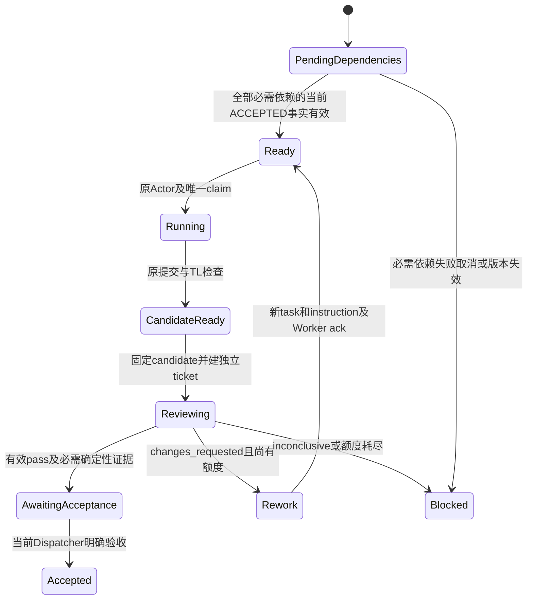

# N4-B：最小 DAG 与版本化独立审核票据

状态：**拟议设计；未实现、未执行以下验收**。基线与授权见[索引](README.md)。
本卡将 B1 拆成一个三节点汇合及一个固定候选的审核闭环，不一次扩展通用 capability/MCP。
首个图为 `a → c ← b`，a/b 可独立推进，c 的两个必需依赖都 ACCEPTED 才能就绪。
至少一个候选经独立审核子请求，覆盖 pass、changes_requested、inconclusive 和轮次耗尽。
首版不开放用户豁免、不执行真实供应商或任意进程。

## 当前接口、已存在结构及未实现范围

| 当前路径/公开符号 | 实际能力 | 本卡要补的边界 |
| --- | --- | --- |
| [store.hpp](../../../include/wls/store.hpp)：`publish_plan`、`apply_independent_plan`、`apply_independent_dispositions`、`create_task`；[store.cpp](../../../src/store.cpp)：`Impl::independent_nodes` | 普通独立节点原子计划/分配；原需求、任务 CAS 和 AMEND 处置 | `independent_nodes` 明确要求 depends_on 为空且无 review/capability/input；不可直接放开这个条件冒充 DAG |
| `Store::submit_work`、`current_submission`、`check_submission`、`accept_candidate` | 原始有界实际文件快照，TL 检查、有限返工、Dispatcher 验收 | `accept_candidate` 明确拒绝需要独立审核的任务；CANDIDATE_READY 不代表独立 pass |
| `Store::change_task`、`escalate_task`、`rejected_submission`、`report_experience` | 已拒绝成果的原版本纠正/升级及冻结计数；原经验 source | 这些不是审核子请求的 creation/claim/verdict 接口，不能据此代签新票据 |
| [task_engine.hpp](../../../include/wls/task_engine.hpp)：M1 `TaskEngine::submit_candidate`、`record_review`、`accept` | 单宿主 Journal 合成 Candidate/ReviewRecord；有不同审核团队及版本检查 | 独立于 S1 SQLite、无模型/真实文件执行；不能把 M1 review 当作 S1 ticket 或把 Journal 导入 Store |
| [schema.sql](../../../db/schema.sql)：`task_deps`、`review_tickets`、`review_results`、`verification_runs`、`artifacts` | 已发布的参考数据结构和不可变 trigger | `task_deps` 没有 plan_revision，旧票据列未覆盖完整 producer execution/policy tuple；结构存在不等于当前 C++ 运行器已接入 |
| [review_request.schema.json](../../../schemas/review_request.schema.json)、[review_verdict.schema.json](../../../schemas/review_verdict.schema.json)；[validate_contracts.py](../../../scripts/validate_contracts.py)：`validate_review_response`、`require_product_acceptance` | 冻结 candidate/hash/submission/round、生产语义/Dispatcher 与 reviewer 完整版本；确定性证据和模型 verdict 分开校验的离线参考 | 这些函数不是 C++ Store 的事务授权；JSON 形状通过不能作为审核派发或产品验收 |
| [async_coordinator.hpp](../../../include/wls/async_coordinator.hpp)、[scheduler.hpp](../../../include/wls/scheduler.hpp)：`submit`、`submit_fair`、`WorkClass::Review` | 已有两池公平、有限队列、1/1 reserve 和跨池资源 FIFO | Review 是排程类别，没有 reviewer 权限、票据或独立业务结论 |

当前 `workflow_submissions` 的原 binding/body/artifact_snapshot/record_sha256 不可变；
`artifacts` 和 `review_tickets` 的 candidate_ref 外键不能通过随意把 submission_id 当 artifact_id 满足。
必须显式定义这两个现有模型之间的映射，保留原字段含义。

## 拟议接口与最小实施分界

以下为待协调者采纳的名称/语义，当前接口中不存在；候选放在原 Store、OfflineRuntime、
事件驱动模块及新的 `src/store_dag_review.inc`，不改 M1 Journal 协议。

| 拟议接口 | 核心输入/输出 | 单事务要求 |
| --- | --- | --- |
| `Store::apply_dag_plan` | 当前 Dispatcher、请求 CAS/requirements、原 Plan、完整节点处置和固定图版本 | 校验全集/环/容量/权限后，原子提交计划、节点/边、就绪投影和唤醒；任何错误零部分分配 |
| `Store::dag_ready_tasks`（只读）、内部 `authorize_dag_dispatch` | 只读候选清单；首次派发/业务提交另复查当前图和依赖证明 | 清单只是观察；`reserve_attempt`、`claim_offline_call` 及业务提交都不能绕依赖/原 UNKNOWN/当前 tuple |
| `Store::prepare_review` | 生产 Dispatcher 原绑定、task/submission CAS、已固定候选、获准 reviewer 目标及双边预算政策 | 原子保存 candidate 映射、不可变 ticket、目标子请求关联与待办；跨请求两个权威都核验，不用生产 Actor 扮演 reviewer |
| `Store::record_review_verdict` | 真正 reviewer Actor、原捕获 ticket/双边 tuple、原 attempt/settlement/feedback、模型 verdict | 原双边目标/epoch、claim 和票据一致；保存原报告及有效性投影，事务内推进待验收/返工/升级；同键重放不加轮次 |
| 受控 `accept_candidate` 新协议分支 | 原 Dispatcher 验收及 ticket/current candidate/独立 host verification 引用 | 必须独立 pass、必需确定性检查通过且原 S1 验收守卫全部满足；无该协议仍保留现有 Unsupported |

建议分两次小实现验收：先图发布/就绪/失败事务；再票据/审核/有限返工。
采用 [N4-A](01-async-inbox-driver.md) 已核准的持久关联和部分确认规则后接异步管理调用。
生产 file/submit 仍走现有同步 WorkerTools/EventRuntime 的真实受控路径；异步首片没有 file executor。
最小纵向测试可以在明确阶段边界 drain/close 后交还 Store，再用新的同步调用生产实际文件候选，
或全程同步验证图/票据后另测异步 reviewer 调度；不能在 callback 内调用 WorkerTools，
不能将同一 attempt 同时交同步和异步执行，也不以夹具 SQL 伪造 accepted/submission 行。
若该阶段切换无法保留原 Store owner/claim/预算，先停在图/票据组件，后继另审执行相位接口。

## 图版本、失败传播与原持久事实

**任何新表、迁移和协议字段均待架构选择，尚未批准。** 最小逻辑持久集如下：

| 事实 | 必须固定/可恢复的内容 |
| --- | --- |
| 图版本 | request_id、requirements_revision、plan_revision、规范 Plan 原字节/hash、全部节点/边、可选失败政策的显式版本；旧图保持可查 |
| 节点当前投影 | 原 task_id/team_id、task CAS、当前 graph 版本、等待依赖集合、失败/阻塞原因和原因版本；不要用计算队列替代持久权威 |
| 依赖满足凭据 | 对每条边记录 predecessor 的原 task/submission/candidate/hash/acceptance 及版本；不能只保存 `ready=true` |
| 审核关系 | candidate 映射、ticket、双方完整冻结 binding、原 call/attempt、审核轮次/原上限、verdict、确定性检查及失效原因 |

保留历史 SQL/Schema 资产原字节和已发布指纹。新增资产须更新当前注册、catalog/manifest，
不能改旧条目含义或将旧 hash 重定向到新字节。当前 `task_deps` 的无图版本主键不足以
存储不同计划的全部历史边，不能覆盖旧边后宣称历史完整。候选是新增版本化边/审核扩展事实，
或以不可变 plan 正文为历史权威并另存当前索引；两者都须有容量、回滚、旧 402–410 解释与迁移方案。
未决定方案时新增接口返回 Unsupported，不能把旧请求静默升级为新图。

无环校验在提交事务内针对完整候选图：唯一节点、端点存在、同请求/图版本、无自环/重复边、
无间接环、模板/能力/约束及冻结 team 上限。最小片保持原最多 20 节点与更小冻结 team 上限，
不能仅因 Schema `depends_on` 允许 20 项就扩大任务容量。拓扑计算有界且无 Store 锁内模型等待。

图中为逻辑状态；当前 submission 没有 `Reviewing` 枚举，后继须决定独立投影而不是直接写非法值。
必需依赖 FAILED/CANCELLED/SUPERSEDED 或验收被撤销时，后继阻塞并产生该原因的 Dispatcher 待办；
不能自动把 UNKNOWN 变 FAILED。已在途后继的旧结果仍记账，派发/提交门禁拒绝新业务。
可选依赖首版仅接受计划中明确的策略：成功后使用固定成果，或允许已明确 FAILED/SKIPPED 后继续并披露；
未表达政策就阻塞，不能按 `required=false` 自动忽略失败。新政策表示法需版本化，原 Plan 不能加未知字段。
AMEND 仍逐任务 update/keep/cancel，遗漏保持暂停；旧图唤醒和旧依赖凭据不为新图取得许可。
取消/返工不删除已捕获文件、原 verdict、旧图或副作用证据。

## 双方票据、返工和容量

候选哈希须来自宿主已经保存的完整 `workflow_submissions` 原始文件集合与版本化规范封装；
定义精确包含路径/大小/原文件 hash/内容关系、submission 身份及原 binding，保存其字节，
不能采用模型自报 hash、当前工作目录或含可变 status/CAS 的整个查询 JSON。
candidate_ref 与 artifacts 的映射一次写定；同 hash 不授权另一 submission/版本。

| 票据域 | 要求 |
| --- | --- |
| producer | request/task/team、requirements/plan/task/instruction、dispatcher/execution/policy epoch、task/submission CAS、candidate_ref/hash、submission_id |
| reviewer | 独立 request/task/team、requirements/plan/task/instruction、dispatcher/execution/policy epoch、原 reviewer CAS 和本次 call/attempt |
| review | review_id、round、冻结 max_rounds、原 input/hash、必需 checks、原 provenance；model 输出只给判定/问题/证据，不指定或刷新身份 |

现有 ReviewRequest/SQL 保留 producer dispatcher_epoch，但未提供上述全部 producer execution/policy 域；
需要版本化 host envelope 或附加事实，不能把 reviewer 字段冒充生产字段、在旧 Schema 塞字段或改旧 hash。
`writer_session` 继续是当前 Store 的临时授权，不作为可跨重启复制的历史票据权限。
响应到达与最终验收都核对双方当前 tuple；任何一方恢复/重绑/改说明，旧 verdict 仅保留为历史，
不能改盖新 epoch。若语义候选仍有效，使用新 ticket 和新计费 attempt 重新审核，不能复用旧批准。

reviewer 必须是经宿主许可的另一审核子请求/团队与权限作用域，来源映射不能由生产模型选择。
最小片只允许一个已批准的本地审核能力映射；原请求准入身份、配置和工具 allowlist 保持。
现有跨请求 Store 范围限制需显式满足，不以公开构造 Actor 或 `WorkClass::Review` 获权。
“非生产者的 runtime 审核角色”与开发时主协调者的正式 PR 批准是两种不同事实。

changes_requested 原样保存 findings，使用有版本 ChangeOrder 和新的 task/instruction 后要求重新 ack。
review round 与 `team_internal_rework_max` 分开计数，但首版不因外部审核重置既有共享纠正计数；
两种上限都满足才返工。max_rounds 保持原 Schema 的 1..5 与更紧冻结配置；精确重放不增轮次，
inconclusive、无额度或未知账目进入 BLOCKED/用户升级，用户答案不赠送额度或批准。
首次预算方案建议所有审核费用受生产请求明确预留的总上限约束，审核子账本归属和总额守恒须先批准；
不能给每个 review child 创建一份无关的新总预算来绕原限制。

管理/Worker 两种 Review reserve 在普通准入时同时保留；producer 等待审核释放活跃执行槽，
但未结算预算、保留响应及仍有冲突的资源不释放。reviewer 只读不可变候选快照，使用独立审核资源键，
不得等待一个仍由 producer 同步持有的槽或文件锁。A4 的原 FIFO、Ready/Retained 持有和有限结果容量保留。
失去当前票据资格仍要保存原响应/usage；停止或恢复不是免费重试、业务验收或退出证明。

## 最小验收与退出

所有用例为计划，先采用真实临时 Store、受控实际文件及 FakeModel，禁止手工造业务成功行。

| ID | 正例与负例 | 必须验证 |
| --- | --- | --- |
| B01 | 三节点汇合；自环、间接环、未知端点、重复边、超容量 | 合法图全量原子提交；错误图无 plan/task/team/边/预算半写 |
| B02 | a 先接受、b 仍运行；b 失败、取消或 UNKNOWN | c 不提前派发；明确失败传播待办，UNKNOWN不补失败；可选边只按批准政策处理 |
| B03 | AMEND/新plan与就绪竞争、缺一项处置、旧图重启 | 首次claim/最终业务提交复查图版本；旧 Actor/旧依赖唤醒无新效果；历史字节保留 |
| B04 | 固定候选合法独立pass；换内容/hash/submission、生产者代签 | 原票据/真实reviewer通过；同内容另一版本也不能套旧票据；原请求/任务/预算隔离 |
| B05 | producer或reviewer各自恢复、改说明/政策、迟到回包 | 双方每个epoch/CAS分别拒绝；不得刷新ticket/Actor；迟到原usage/response仍可追溯 |
| B06 | changes_requested、inconclusive、最后一轮、同键重放 | 有限返工与新ack；计数不重置、不重复扣/赠额度；耗尽明确升级；所有findings留存 |
| B07 | 双池普通满载、两个review角色推进、跨请求资源后继 | 两种reserve均有效，等待方不占执行槽，原FIFO及公平；结算故障保留容量并围栏 |
| B08 | verdict=pass但确定性检查fail/not_run/缺失；缺必需review直接accept | 必须拒绝；模板或模型自报不能补host证据；原交付/UNKNOWN/终态门禁不变 |
| B09 | ticket前后、verdict前后、验收前崩溃及旧库打开 | 唯一派发和exact replay、原子事实、旧410可解释；未支持升级拒绝而不改历史 |

依赖 [N4-A](01-async-inbox-driver.md)、A3/A4、原问答/提交/验收及 ADR-070/073/091。
若先做同步组件，不宣称完成异步 DAG；若只完成 Schema/离线合同，不宣称 S2 生产闭环。
后继实现在原 Store/event/workflow/acceptance/recovery/async/scheduler/contracts 套件加入真实场景，
按影响补预算、清理终态及历史升级回归，并完成同一输入的完整适用 Linux 门禁。
退出要求协调者采纳版本/预算/映射方案、三节点真实纵向结果、独立双方身份复核及原字节/失败证据。
通用 capability、跨宿主审核、真实模型质量、自动豁免、记忆与公网服务继续后置。
