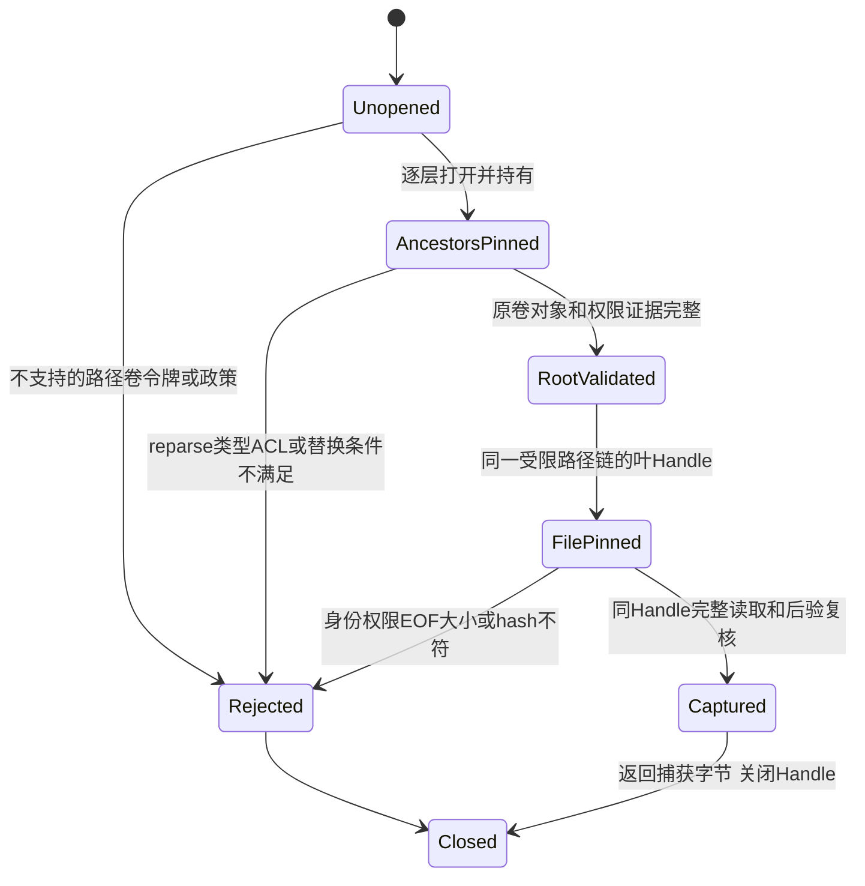

# N4-C：Windows 最小只读对象身份与公共资源捕获

状态：**拟议设计；未实现、未执行以下验收**。精确输入与授权见[索引](README.md)。
首片在独立 native-foundation 上补根 Handle/对象身份和 ACL 边界，仍只读取编译认可的公共资源。
目标平台首先是 Windows 11 x64、本机 NTFS、普通非提升用户；具体 build 与工具链由协调者冻结。
本卡不开放业务 `/work`、私有配置/凭据、Store/VFS、进程启动、沙箱、发布、删除或 cleanup。

## 当前公开接口与平台边界

| 当前路径/符号 | 现有实现事实 | 尚不能声明 |
| --- | --- | --- |
| [native_foundation.hpp](../../../platform/native-foundation/include/wls/native_foundation.hpp)：`PublicResources::from_bundle`、`discover`、`bytes`；[public_resources.cpp](../../../platform/native-foundation/src/public_resources.cpp) | 固定编译 manifest/hash/大小的公共字节捕获；只从显式根或实际 executable 相对位置读取，成功后消费者用内存字节 | 没有私有 DACL/owner 验证；不是安全安装器、Workspace 或整个目录同时刻快照 |
| [system_windows.cpp](../../../platform/native-foundation/src/system_windows.cpp)：内部 `Handle`、`pin_directories`、`information`、`Directory::read` | `CreateFileW` 固定每层祖先并拒绝 write/delete sharing；拒绝 reparse、错误类型、多硬链接；同 Handle 有界读取到 EOF，前后身份/大小/时间和 hash核验 | 内部类型不是公开 API；已有 `BY_HANDLE_FILE_INFORMATION` 的卷序号/file index 不等于通用跨重启授权或完整 ACL证明 |
| 同头 `host_facts`、`capabilities`、`require_business_capability`、`actual_executable` | elevation/可执行卷文件系统观察、明确 unsupported/denied、原生可执行定位 | `host_facts` 没有检查任意输入根的卷；not_elevated 不证明目录ACL安全，doctor/available不授予StoreActor |
| [runtime_resources.hpp](../../../include/wls/runtime_resources.hpp)：`RuntimeResources::from_bundle`；[migrations.hpp](../../../include/wls/migrations.hpp)：`MigrationRegistry` | Linux 完整捕获和已发布 SQL/Schema 指纹；消费者读取固定字节 | 不能通过替换源码文件让 Windows 直接安全打开生产 Store |
| [workspace.hpp](../../../include/wls/workspace.hpp)：`Workspace`、`root_identity`、`dup_root_fd` | 明确 Linux-only，openat2 原解析及 `{path,device,inode}`、int fd | HANDLE 不得强转 fd；Windows 卷/fileID 不伪造为 device/inode，不接管旧活动工作区 |
| [native CMake](../../../platform/native-foundation/CMakeLists.txt) 与 [平台实现契约](../windows-native-foundation.md) | 原生 config/Scheduler/资源四项 CTest，Windows MSVC/SDK 固定构建集合 | 四项组件或 Server2022/elevated 成功不等于 Win11 普通用户或完整 runtime |

现有原生 reader 已有 Handle/EOF/编译摘要守卫。本卡补其明确缺口，不把所有现有读取描述为
无保护，也不无依据声称已复现权限漏洞。新安全性质先写下威胁模型、原生竞争试验和拒绝边界。

## 拟议接口与状态

候选继续放在 `platform/native-foundation`；建议新增
`include/wls/native_readonly.hpp` 和 `src/readonly_windows.cpp`，名字待采纳。
不移动 Linux 生产实现，不添加通用平台句柄转换，不削弱顶层 Linux CMake guard。

| 拟议类型/方法 | 数据与所有权 | 明确限制 |
| --- | --- | --- |
| `ReadOnlyRoot::open` | 受信宿主给绝对根、显式支持政策；返回 move-only 根对象，内部 RAII持有根和全部必要祖先 HANDLE | 先验证支持/类型/权限才数据读取；模型不能传宿主根或扩大政策；HANDLE不外借、不继承、不序列化 |
| `ReadOnlyRoot::identity` | 版本标记 `windows-object-observation-v1`、卷身份、128位fileID、类型/reparse tag、捕获会话、owner/ACL政策摘要 | 是有界观察；仅同一存活Handle中的authority可继续用，序列化JSON不是重开许可 |
| `ReadOnlyRoot::read_registered` | 编译注册相对路径、expected size/hash和既有读取上限；返回完整捕获字节与原对象观察 | 不接受任意 `/work` 或用户文件路径；没有 write/list/delete/execute；失败不返回“完整”前缀 |
| `PublicResources` 的显式安全捕获入口 | 使用新 reader 取得原 manifest和资源，核完后一次返回不可变集合 | 原 `from_bundle/discover` 的历史语义保留；新入口/政策需显式选择，尚未验证不可默认为私有安全模式 |

此状态只在当前捕获生命周期存在，不写 SQLite，不形成 owned resource 或清理 claim。
manifest 与全部资产均成功才返回 PublicResources；不同文件按编译认可字节检查，不宣称
目录所有条目同一时刻的原子快照。中断后重新开一次安全捕获，不重用 JSON中的旧 HANDLE/fileID当授权。

## 根、卷、重解析与替换保证

首片保留现有每层 `FILE_FLAG_OPEN_REPARSE_POINT | FILE_FLAG_BACKUP_SEMANTICS`、
固定本地 drive、无 write/delete sharing 的 Handle 链，不仅对最后一个路径加标志。
每层都验证 disk/directory、非 reparse、所属卷，最后文件验证普通磁盘文件且 link count=1。
所有必要祖先持有到本次捕获结束；共享冲突显式拒绝，不能放宽 sharing 以让演示通过。

对象身份候选使用 `GetFileInformationByHandleEx(FileIdInfo)` 的卷序号及128位 file ID，
配同 Handle 查询的卷类型/卷标识与创建/修改等观察；明确序列化宽度和字节序，不能截成32位。
初始本机 NTFS 支持集合须实测这些查询可用、稳定和失败码；不支持即 Unsupported。
fileID 可能重用，所以跨重启只报告历史观察，不以相同名字或 ID恢复权限。
`GetFinalPathNameByHandleW` 仅供诊断/别名核验，字符串前缀不能作为祖先关系证明。

本卡建议先复用已持有祖先、拒绝替换共享的路径机制，以实际原生测试证明检查与打开之间的对象链稳定。
必须对父重命名/删除子项/重解析修改分别试验，并验证最终持有对象确属已验证链。
若 Win32 路径打开加共享约束仍无法证明所需保证，停止该支持档位并交协调者选择受审的相对父Handle解析方案；
不能先改用普通字符串 canonicalization、检查后重开、宽松 sharing 或未评审 NT API 兜底。

## ACL/SID政策与只读预算

首片威胁模型针对其他普通身份及可写目录替换，信任当前受控宿主及明确批准的 OS 管理主体。
不声称防御恶意管理员/SYSTEM、内核或任意同 SID/同进程宿主代码。
建议初始可信集合为当前用户及明确列入政策的 SYSTEM/Administrators；该集合必须由协调者采纳，
不能仅凭 owner 是管理员、DACL存在或令牌未提升就通过。其他服务 SID、域组和未知ACE需要单独政策。

使用实际 Handle 上的安全描述符查询，读取 owner、DACL及必要的完整性/有效token信息。
对当前进程有 impersonation 的情况明确拒绝或验证实际有效令牌；不能只看进程 TokenElevation。
对象检查需要 `READ_CONTROL` 等最小观察权，获取失败给 Denied/NotChecked，不默认为安全。
空/NULL DACL、未知/无法解释的ACE、宽泛主体有危险权限、无法判定继承结果均拒绝。
受限首片可只接受能够完整解释的ACE集合，复杂条件ACE暂不支持；不得用“找到一条deny”忽略其他allow。

| 对象 | 必查风险 |
| --- | --- |
| 根与每个必要祖先 | 非受信主体的 `WRITE_DAC`、`WRITE_OWNER`、DELETE、目录 `FILE_DELETE_CHILD`，以及允许替换下一层对象的创建/写入权；检查父权限，不能只看叶DACL |
| 目录内资产路径 | 不允许非受信主体通过继承、junction、mount/reparse、大小写/短名别名替换注册路径；叶名和真实对象双核 |
| 最终文件 | 非受信主体的写数据、追加、属性/reparse、安全描述符变更、删除/替换与硬链接；ReadOnly属性不等于权限隔离 |

ACL只读检查不修改 DACL、不接管拥有者、不启用备份权限；权限变化前后检查本身不能防任意对手的瞬时
修改。需要依赖已批准ACL政策排除该对手修改权、持有对象和真实竞争证据共同成立。
有威胁模型内可修改ACL/链路且无法排除时返回拒绝，不能将一次“前后相同”当成安全证明。

保持严格 UTF-8/UTF-16、NUL/控制字/点点/ADS/设备/UNC/驱动器相对/尾点尾空格拒绝。
允许中文与emoji不静默归一化改名；不依赖区域lowercase。8.3、大小写敏感目录、短名/硬链接别名
若没有充分证明，列 unsupported。不扩大原路径4096字节、注册相对路径512、manifest64KiB、
每资产1MiB、总8MiB上限；完整EOF与实际size/hash同验。所有消费者只使用返回的已核字节。

公共观察日志可记录机制、结果码、字节数与摘要；完整 SID/ACL、绝对路径和宿主事实原件私有保存，
公开投影单列来源/范围/hash。读取资源不授予配置或凭据访问，不输出完整 doctor 对象。

## 支持矩阵与最小原生验收

下表是目标及拒绝策略，全部新验收为 **PLANNED / NOT_RUN**，不覆盖 N3 的实际报告。

| 组合 | 此卡预期 |
| --- | --- |
| 已冻结 Win11 x64 build + 普通非提升令牌 + 本机NTFS + 明确ACL政策 + 原工具链 | 只有原生允许/拒绝/竞争结果齐全才支持新只读档位 |
| Windows Server2022或elevated hosted CI | 可作组件构建/辅助证据；不能代替上行普通用户目标；按实际OS/权限独立列结果 |
| ReFS/FAT、UNC/网络、云占位/重解析、未知卷或fileID能力 | Unsupported/Denied，在数据读取前退出 |
| ACL不可读/无法解释、父可替换、共享冲突、未知effective token | 拒绝；不自动提升、不改账户政策或放宽sharing |
| Linux native组件回归 | 验兼容和公共字节，不证明Windows ACL/Handle行为 |
| WSL/Wine、Store/业务Workspace/任意run/强隔离/cleanup | 不属于本原生切片；业务能力维持原Unsupported/Denied |

| ID | 实际可构造用例 | 必须证据/失败界限 |
| --- | --- | --- |
| C01 | 普通用户私有测试根，中文/emoji重定位，删除原源码后完整资源捕获 | 根/卷/fileID、ACL政策、原manifest与每资源字节、EOF、大小/hash；不回退cwd或环境 |
| C02 | 叶与中间层junction/symlink/reparse，UNC/ADS/设备/短名/硬链接 | 访问目标正文前拒绝；真实对象构造前置失败须记 NOT_RUN，不伪造原生结果 |
| C03 | 另一个普通身份有叶写权、父DELETE_CHILD/替换权、宽泛/NULL DACL | 原生权限先决条件确证后调用；拒绝且没有数据/ACL/目录业务写入；不在生产账户上改策略 |
| C04 | barrier控制检查后、打开前、读取期间的父替换/rename/reparse/ACL变化 | 被共享/权限拒绝，或安全读取同一验证对象，或调用明确失败；不能读入替代对象；无sleep猜时序 |
| C05 | 内容同大小篡改、增长/截断、EOF缺失、manifest自报新hash | 保持编译认可原字节，拒绝完整capture；同名路径/同size不能通过 |
| C06 | fileID/卷/权限查询失败，异步关闭与Handle继承检查 | 清晰失败码、无Handle泄漏/继承；序列化历史观察不能重开授权；不fallback普通路径读 |
| C07 | 支持集合外请求、原四项组件回归与非法业务命令 | 不扩大能力清单；命令保持原非零拒绝；Linux语义及原资源指纹未改变 |

测试只在获准临时根/临时runner身份下操作合成数据。没有Win11普通用户机器就保持该目标NOT_RUN，
可完成代码/辅助CI后交回，不能购买资源或改宿主全局权限来宣称完成。
单次报告记录同run/job/attempt/checkout、OS build、image两个来源字段、token、实际目标卷、
MSVC/SDK、源输入和PE身份、原完整LastTest、命令/退出与各拒绝前置；保留冲突而不选有利值覆盖。

## 退出与后继边界

退出要求协调者采纳支持/ACL/祖先解析方案，真实Win11普通用户正负例与竞争证据、完整EOF/资源身份、
非作者Windows权限复核、原native四项和实际新增项的独立计数。必要新增注册先更新原生清单/证据工具；
不能把原生四项加到Linux92项，也不把工具自检当产品套件。

通过只可声明“指定Windows组合的只读根对象与公共资源捕获已验”。下一卡再设计带平台版本身份的
Workspace、控制文件/SQLite锁与VFS；后面才是受控进程、完整隔离/网络、真实退出和owned cleanup。
Job Objects、ReadOnlyRoot或恢复成功均不是沙箱/退出/清理证明；本卡没有批准新SQL、进程监督、
强隔离实现、生产目录访问或跨平台活动状态迁移。
