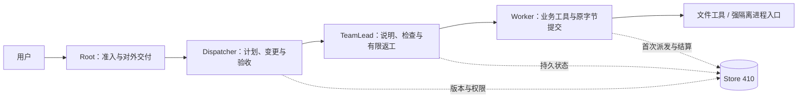

# wls861 主线完整交接（2026-11-12）

本页是当前项目的完整接手入口；[STATUS](../STATUS.md)提供能力快照，[G1 结果页](../reports/g1-exit.md)提供简短结果与限制。
实现版本仍为 **0.11.1-r3.3c-audit**，目标蓝图 **v0.4.1**，数据库 **Store 410**；没有发布新版本。
**产品合并基线为 main@`b09848e787e307a002ab97282c1b3d95901a397f`，G1-A–M 已普通合并；本文属于随后文档提交。**
状态快照：2026-11-12 23:28:39 UTC；在途CI以所链接run的后续实际状态为准。
合并是 owner 本次明确要求的正常整合；不代表完整 sanitizer 矩阵通过、G1 正式验收或真实模型获准。

## 1. 阅读顺序与事实基线

先读 [AGENTS](../../AGENTS.md) 与仍有效的[完整开发契约](../implementation/development-contract.md)，再读本页、[开发路线](../ROADMAP.md)和[05 开发计划](claude-2026-11-11/05-development-plan.md)。
产品目标以[实施规格 v0.4.1](../spec/v0.4.1/01_实施规格_v0.4.1.md)为准；实现契约与实际验证报告界定现有能力。
2026-11-11 审计目录的原文冻结，05 仅维护 §2 状态列及末尾执行附录；其中 v0.5 提案仍未批准。
`docs/handoff/v0.3`、`v0.4` 是历史原件，包含的旧指令、状态和批准表述不能替代当前约束。

| 对象 | 精确身份 / 状态 |
| --- | --- |
| 本页产品合并基线 | [`b09848e787e307a002ab97282c1b3d95901a397f`](https://github.com/wmqfl861/wls861/commit/b09848e787e307a002ab97282c1b3d95901a397f)；#66于2026-11-12 23:09:34 UTC普通合并 |
| A 后续 PR #62 head | `a862ad102b226792fcbdecfff18667fc74d760fa`；2026-11-12 22:49:24 UTC 普通合并为 `b267ae5b7f2d0fff7c20d78225c5263ebd2fcd33` |
| M PR #66 | 合入A后head `c2aa6440dec010b9161527c1c80d6b75ccf2081a`；该head与上述main的tree均为 `801d51e65fbf8ca2735f9cb03058f20948167511` |
| 新M组合本机 / CI | 单次注册G1 1/1 PASS；PR三核心各83/83 PASS、source SUCCESS；新main full IN_PROGRESS，旧结果不转记 |
| 本文档提交 | 属于随后独立的文档提交；产品基线不随文档提交自动获得新的测试结果 |

六项状态分别登记；`SCOPED_PASS`只表示所列范围通过，`NOT_CLAIMED`表示没有代签正式PR评审。

| 状态字段 | A #62 | M #66 |
| --- | --- | --- |
| IMPLEMENTATION_COMPLETE | YES | YES |
| LOCAL_VALIDATION_COMPLETE | PARTIAL；capture OPEN | SCOPED_PASS；G1一次1/1，非83项全跑 |
| PUSH_COMPLETE | YES | YES，head `c2aa644`与main合并均在远端 |
| REMOTE_CI_COMPLETE | YES；PR及main完整矩阵PASS | PARTIAL；PR三路83/83 PASS，main full IN_PROGRESS |
| PR_REVIEW_COMPLETE | NOT_CLAIMED | NOT_CLAIMED |
| MERGED | YES，`b267ae5b` | YES，`b09848e7` |

历史sanitizer问题仍OPEN；上述实现/推送/合并状态不能相互代替，也不构成G1正式验收。
本文随后文档变更的提交、CI与合并状态以承载本页的GitHub PR记录为准。

## 2. 项目目标、架构与代码入口

项目目标是可配置的 C++20 通用多 Agent 工作流：一个请求一个 Dispatcher，团队内 TeamLead 与 Worker 一对一，支持变更、恢复、受控工具、验收和交付。
目前提供持久化的本地 CLI/库和合成验证链；`wls861` 保留早期 M1 内核，`wls` 承载 S1 工作流。



Root 接收原请求并处理已验收成果的技术发布；上层角色不获得 Worker 业务工具权限。
Store 保存冻结配置、原请求/响应、版本、执行代次、事件、调用与费用；模型输出须经过 Schema、捕获绑定和提交时权限检查。
UNKNOWN、待处理 AMEND、未结算调用与未回答问题保留各自围栏；恢复或重放不授予再次发送/执行权限。
文件交付来自不可变的已验收快照；取消不能证明副作用撤销，workspace 清理完成也不代表全部私有数据已清除。

| 查找内容 | 当前入口 |
| --- | --- |
| CLI / 一键请求 | [`src/cli.cpp`](../../src/cli.cpp)、[`src/run_cli.inc`](../../src/run_cli.inc)：`wls run` 的确认、准入、续批及本地交付 |
| 角色工作流 | [`src/event_runtime.cpp`](../../src/event_runtime.cpp)、[`src/offline_runtime.cpp`](../../src/offline_runtime.cpp)：live/FakeModel 事件循环 |
| 权限与耐久状态 | [`src/store.cpp`](../../src/store.cpp)及其 `store_*.inc`；`include/wls/store.hpp` 是宿主 API |
| 冻结配置 / 上下文 | `src/config_loader.cpp`、`src/context.cpp`、`src/structured_context.cpp`、`src/structured_history.cpp` |
| 工具 / 工作区 / 进程 | `src/worker_tools.cpp`、`src/workspace_posix.cpp`、`src/sandbox_posix.cpp` |
| 协议 / 传输 / 费用 | `src/protocol_codec.cpp`、`src/sse_replay.cpp`、`src/https_transport.cpp`、`src/live_model.cpp`、`src/billing.cpp` |
| 构建 / 验证 / 资源 | `CMakeLists.txt`、`Makefile`、`.github/workflows/ci.yml`、`tests/`、`scripts/`、`db/migrations/`、`schemas/` |

结构查询先使用已安装的 codebase-memory skill；索引覆盖不足、过时或 `.inc` 不可解析时读取当前源文件。
以上是接手定位，不代表图索引已穷尽调用关系；运行时规则仍以当前源代码及契约为准。

## 3. G1-A–M 实现与合并账目

所有下列已合并项使用正常 merge；完整 SHA 可由相应 PR 或提交链接核对。此前 #48/#49 已提供 Responses 兼容与冻结单价估算。

| 模块 | 已实现范围 | PR / main merge |
| --- | --- | --- |
| A | PR 测试分层；后续上下文校验复用、注册分组和 Make/CMake ASan 分片 | [#53](https://github.com/wmqfl861/wls861/pull/53) `ce6fe0d907e286593df66288ab7149dc0af60b94`；[#62](https://github.com/wmqfl861/wls861/pull/62) `b267ae5b7f2d0fff7c20d78225c5263ebd2fcd33` |
| B | 持久化模型输出纠错回路 | [#55](https://github.com/wmqfl861/wls861/pull/55) `951c95d30fbc19f7571aa851cf9669c0aea42ec1` |
| C | 工具及参数说明文字 | [#56](https://github.com/wmqfl861/wls861/pull/56) `c783d9e975c403de45c2ec097cbbce43a3897e0d` |
| D | 提示词、环境卡片与规则段 | [#57](https://github.com/wmqfl861/wls861/pull/57) `26403c4b1ebcddb93ec3419cba5121b14aa58001` |
| E | `structured-v3` 请求布局与冻结准入 | [#60](https://github.com/wmqfl861/wls861/pull/60) `e7c48c05bcf96c34d501871abd3f208a0299facd` |
| F | 固定角色工具目录与当次允许列表 | [#63](https://github.com/wmqfl861/wls861/pull/63) `d6b2ab49fb44f57ca1b4c0df10c4ea7a5450a8aa` |
| G | `lean-v1`：元数据不出站、读取结果去重、契约文本 | [#64](https://github.com/wmqfl861/wls861/pull/64) `83ddb872458534d177141940943b3d3f4e005e98` |
| H | 追加历史、批量折叠及原文回读 | [#65](https://github.com/wmqfl861/wls861/pull/65) `4fbc1803bfa7644c3c6db6ad20211a0b477779cb` |
| I | 冻结 DNS 与显式可选代理策略 | [#54](https://github.com/wmqfl861/wls861/pull/54) `231291efd25fa3bd60a6e06f78c65a4351ecb948` |
| J | 付费保护、有界自动续批、输出上限和输入估算 | [#58](https://github.com/wmqfl861/wls861/pull/58) `32c3a41f16df75238bff71d815c6d31b043b9255` |
| K | 允许未知元数据键并记录；拒绝未知输出项类型 | [#59](https://github.com/wmqfl861/wls861/pull/59) `e8287b981840cb68c3ca5df2034f944c6b379e66` |
| L | `wls run` 一次确认、有界推进与本地交付 | [#61](https://github.com/wmqfl861/wls861/pull/61) `aca8155b59fb95beb32b5b3b95d3e06c391ddbd2` |
| M | G1合成验收注册与H的两项实际产品修复 | [#66](https://github.com/wmqfl861/wls861/pull/66) `b09848e787e307a002ab97282c1b3d95901a397f` |

#62 不是纯 CI 变更：其产品候选 `fba19b59853f56af8059121bd5e7dc9a28711c6a` 复用单次验证内的上下文派生；最后 `a862ad1` 只调整 CMake ASan 完整矩阵分片。
#66 也不是纯测试：除测试注册外，含 H 的测量预约与逐 attempt 有效结算就绪修复（产品 29 行新增、2 行删除），保留最后权限与原账目门禁。
`structured-v3` 在开发计划规定的 G1 总门禁正式通过之前仍视为未发布；本交接不提前宣布冻结或发布。
Store 013/411、异步协调器、DAG 等旧分支仍冻结未合，不属于本次最新 main；不能按旧分支文件宣称当前能力。

## 4. 当前能做什么，哪些仍未完成

已接通持久请求/任务/团队、版本与幂等、逐任务 AMEND、问题/答案、有限返工、候选验收、不可变交付与回执。
文件工具包含 list/read/search/mkdir/write/patch；进程生产入口要求强 bwrap/cgroup 前提，不可放宽为弱模式以获得测试通过。
支持本地 Responses HTTP/SSE 回放、合成 TLS 原发送证据、冻结单价估算、可选签名账单与迟到追加核账。
支持完整历史及冻结窗口、v3 布局、固定角色工具、lean/append-fold；旧请求解释和已发布 SQL 保持兼容。
单逻辑 Agent 连续执行及对照评测框架已有实现，真实供应商质量、成本和缓存表现尚无验收结论。

| 开放项 | 状态与下一条件 |
| --- | --- |
| 当前组合完整测试 / sanitizer | IN_PROGRESS / 本机OPEN；精确观察见 §6，禁止用旧 SHA 绿灯补齐 |
| 真实供应商与付费调用 | **0 / NOT_RUN**；D-2 端点、模型、认证引用及 D-3 预算/执行授权尚未给出 |
| 强沙箱部署正向 | 未验收；doctor 只读前提观察、拒绝用例和监督 fixture 不能替代真实隔离/后代退出证明 |
| Windows 11 | **NOT_RUN**；Linux 本机与 GitHub Ubuntu 结果不能迁移为 Windows 结果 |
| 私有 CI 原始证据托管 | **BLOCKED**；公开安全摘要与本机原件分开保存 |
| 后续产品 | daemon/API、完整记忆/MCP、独立审核团队/DAG、私有行清理及真正并发仍待各阶段实现 |

## 5. 环境、依赖与安全复现

本轮实际本机为 Ubuntu 24.04.1、普通 UID 1000；`/mnt/d` 是 `/dev/vdb2` 的 ext4 数据盘，不是 Windows 文件系统。
工具链实测 GCC 13.3、Clang 18.1.3、CMake 3.28.3、Make 4.3、Python 3.12.3。
依赖实测 Boost 1.83、SQLite 3.45.1、OpenSSL 3.0.13、curl 8.5、LibYAML 0.2.5、jsonschema 4.10.3。
最低依赖与固定第三方字节见 [third_party](../../third_party/README.md)及完整契约；M1 内核保持独立，S1 依赖系统库。
本机使用 `/usr/bin/python3`；CI 会自行建立 venv。旧文档提及的 `.local/test-venv/bin/python` 不是当前本机已存在环境。

以下入口供新环境或有明确复现需要时使用；本次已执行结果见§6，无须为交接重复整套测试。
从准确 checkout 根运行，所有构建、临时证书、SQLite、文件夹具及日志均留在数据盘 Git 外目录：

```sh
test "$(id -u)" -ne 0
umask 0077
WLS_HANDOFF_RUN=$(mktemp -d /mnt/d/codex-workspace/wls861-verify-XXXXXXXX)
mkdir "$WLS_HANDOFF_RUN/tmp"
export TMPDIR="$WLS_HANDOFF_RUN/tmp"
/usr/bin/python3 -c 'import jsonschema; print(jsonschema.__version__)'
cmake -S . -B "$WLS_HANDOFF_RUN/release" -DCMAKE_BUILD_TYPE=Release \
  -DBUILD_TESTING=ON -DPython3_EXECUTABLE=/usr/bin/python3
cmake --build "$WLS_HANDOFF_RUN/release" --parallel 2
ctest --test-dir "$WLS_HANDOFF_RUN/release" -N
ctest --test-dir "$WLS_HANDOFF_RUN/release" --output-on-failure
```

单独重现已合并的一键合成场景使用注册入口；300秒期限不增加：

```sh
ctest --test-dir "$WLS_HANDOFF_RUN/release" -R '^g1_exit_e2e$' --output-on-failure
```

该测试在本机临时建立 TLS 端点、合成凭据和三个文件任务，调用真实 CLI/Store/工具路径；模型响应与缓存规则由夹具确定，不访问真实供应商。
其代码位于 `tests/test_billing_baseline_e2e.py`；`g1_exit_e2e` 与原计费组分开注册，原计费子例不能计为新增 G1 子例。
不要把本页命令改成真实 endpoint 或把生产数据库传入测试；日常配置、凭据和授权必须外置，仓库不存实际密钥。

需要诊断时在独立构建目录显式选 `-DWLS_ENABLE_ASAN=ON` 或 `-DWLS_ENABLE_UBSAN=ON`；Clang 用 `-DCMAKE_CXX_COMPILER=clang++-18`。
Make 的对应入口是 `make -j2 test BUILD_DIR="$WLS_HANDOFF_RUN/make" PYTHON=/usr/bin/python3`。
ASan两片依次运行 `make -j2 asan BUILD_DIR="$WLS_HANDOFF_RUN/make" PYTHON=/usr/bin/python3 TEST_SHARD=1`，再把 `TEST_SHARD` 设为 `2`。
Make 默认 ASan `-O0`、`-Werror`、sanitizer flags、原测试期限与生产权限检查保持；不要删除断言、放宽权限或延长期限处理失败。
现有 CMake/Make 入口会运行归档与契约检查；文档/链接检查、仅列注册项和 Make dry-run 不等于产品测试通过。

## 6. 测试矩阵与证据口径

PASS 只绑定表内 SHA、环境、入口及实际执行范围。一次 CTest 注册项可能包含多个子例；Make 顶层命令、CTest 注册项、unittest 方法与模型调用数不能相加。
PR 核心通常是 strict / umask 0002 / Clang 三配置；完整矩阵另含 UBSan、CMake ASan、Make ASan，共六配置，分片后有八个构建/测试 jobs。
新 M head `c2aa644` 静态确认 83 个 CTest 注册项、Make 59+24 顶层命令、CMake ASan 动态奇偶 42+41；这不是完整执行结果。
共享 Python 入口的选择器为 billing 21 / run 5 / G1 1 方法，all 27 / legacy 26；G1、billing、run 原期限分别为 300/900/600 秒。
新分片先验证无重叠、并集覆盖完整注册，再执行各片；这种静态检查只证明选取完整，不证明运行通过。

| 输入 / 环境 | 入口与证据 | 实际结果 |
| --- | --- | --- |
| M 旧 head `b714cdb8a5c9d8a62545abac517f8f9399aee7d4` / 本机 | `g1_exit_e2e`，私有原件 | 1/1 PASS，28.04 秒；合入 A 前结果 |
| 同一 M 旧 head / GitHub PR | [core 43186230477](https://github.com/wmqfl861/wls861/actions/runs/43186230477)、[source 43186230495](https://github.com/wmqfl861/wls861/actions/runs/43186230495) | 三核心各 80/80 PASS；source SUCCESS |
| A 产品候选 `fba19b59853f56af8059121bd5e7dc9a28711c6a` / GitHub | [full 43262681195](https://github.com/wmqfl861/wls861/actions/runs/43262681195) | 整体 CANCELLED；strict/umask/Clang/UBSan 各 82/82；Make 59+23 命令 PASS |
| 同一候选 / 上述 CMake ASan | 原完整 job | 66 PASS、2 TIMEOUT、1 中断、13 未开始；55 分钟 job 上限，不是完整通过 |
| 同一候选 / GitHub 定向 ASan | [affected 43258653864](https://github.com/wmqfl861/wls861/actions/runs/43258653864) | 六个完整受影响注册项 6/6 PASS；capture 65.95 秒，不替代完整矩阵 |
| 同一候选 / 本机正式 ASan capture | 私有 `ctest.stdout.log` 原件 | 90.17 秒 TIMEOUT，仍 OPEN；不能用 CI capture 成绩覆盖 |
| A head `a862ad102b226792fcbdecfff18667fc74d760fa` / GitHub PR | [core 43275846213](https://github.com/wmqfl861/wls861/actions/runs/43275846213)、[source 43275846242](https://github.com/wmqfl861/wls861/actions/runs/43275846242) | 三核心各 82/82 PASS、source SUCCESS；新完整 ASan 41+41 当时仅静态核对 |
| A 合并 main `b267ae5b7f2d0fff7c20d78225c5263ebd2fcd33` / GitHub | [full 43323428497](https://github.com/wmqfl861/wls861/actions/runs/43323428497)、[source 43323428558](https://github.com/wmqfl861/wls861/actions/runs/43323428558) | full SUCCESS；strict/umask/Clang/UBSan各82/82，CMake ASan两片各41/41，Make59+23命令全部成功；source SUCCESS |
| 新 M head `c2aa6440dec010b9161527c1c80d6b75ccf2081a` / 本机 | 新 Release `-O1 -g0 -DNDEBUG` 构建143.11秒；一次注册 `g1_exit_e2e` | 1/1 PASS，19.80秒（CTest总19.81秒）；未执行全部83项 |
| 同一新M head / GitHub PR | [core 43324561502](https://github.com/wmqfl861/wls861/actions/runs/43324561502)、[source 43324561578](https://github.com/wmqfl861/wls861/actions/runs/43324561578) | 三核心各83/83 PASS；source SUCCESS |
| 产品合并main `b09848e787e307a002ab97282c1b3d95901a397f` / GitHub | [full 43326432461](https://github.com/wmqfl861/wls861/actions/runs/43326432461)、[source 43326432580](https://github.com/wmqfl861/wls861/actions/runs/43326432580) | full IN_PROGRESS；source SUCCESS；与上一main运行独立 |

M的PR核心实际checkout为 `bac6682d25823b1d52148486bc57a964e5a92715`，tree与c2aa/main产品基线同为 `801d51e65fbf8ca2735f9cb03058f20948167511`；记录PR测试身份，不把它写成main自动full。

旧 full 的两个独立超时是 `acceptance_runtime` 90.27 秒、`r3_evaluation` 180.01 秒；`s16_cli_smoke` 在 job 截止时中断。
该 full 内 `r1_structured_capture` 的8种fixture组合共40轮捕获/预约/恢复，在原90秒期限内86.60秒PASS；这是单一CTest注册项、单一顶层case，40是轮数。
b267的CMake ASan两片互斥、并集精确覆盖82项；Make第一片59条=49次C++调用+8个tests/Python入口+2个完整性脚本，第二片23个Python入口，全部成功。
b267完整矩阵于23:26:26 UTC完成；其ASan `acceptance_runtime` 88.23秒、`r3_evaluation` 174.30秒、`r1_structured_capture` 78.98秒均在原期限内PASS。
这证明b267的新分片完整运行通过；前两项距原90/180秒期限余量有限，历史超时根因未闭环。
旧fba失败与本机capture OPEN仍保留，不能据此归因或关闭本机问题，也不等于b098完整通过。

## 7. G1 合成结果如何解释

新 M head `c2aa644` 本机场景独立实测完成 **1 条 `wls run`、1 次确认、3 个文件任务、32 次合成调用**：Dispatcher 4、TeamLead 9、Worker 19。
场景包含自动纠正一次失败读取、无人追加干预、三个交付以及最终费用明细；不要求签名收据。
每个 Worker 任务从第 3 次调用起的模拟缓存读取占比最低 **72.0093408%**，这是逐任务受检调用的最小值。
整体 v3 模拟缓存读取占比约 **62.1915%**，与上面的最小值口径不同；不能报告为整体超过 70%。
同材料 v2/v3 请求体合计 1,384,616 / 1,312,535 字节，v3/v2 比值0.9479415231；v2整体模拟缓存约52.3765%，仅为确定性夹具比较。
按冻结单价估算共 **234,326 micro-USD = $0.234326**；原 cache-write 与供应商实际费用均保持 NULL。
这不是实际付费金额、供应商缓存观测或真实模型质量评测。实际供应商调用与实际付费仍为 0。
新原件核对 input 323,028 / output 224 / cache-read 200,896；32条attempt/发送claim/transport/feedback/用量投影齐全，reconciliation为0。
三个任务均ACCEPTED、三个经验作业DONE，Store仍为410；以上是此次单注册场景的观察，不代表83项完整通过或阶段正式验收。

## 8. 证据位置与可用性

公开可复核入口是上面的 GitHub PR/commit/run URLs，以及仓库内已有报告；Actions 原始日志受 GitHub 保留期与访问权限影响。
本地详细 stdout/stderr、CTest 临时目录、TLS 原字节、SQLite 和合成工作区只保留在数据盘私有目录，不随本次 push 上传。
A 本机正式capture原件已实际读取，`ctest.stdout.log`记录90.17秒失败；其本机来源与旧CI日志分别保留。
新 M 的 `validation-result.json` 及原始证据清单由owner保存在本机Git外私有目录，当前可用；具体本机位置随本次本地交接提供，GitHub克隆不包含这些文件。
该验证摘要SHA-256为 `c8e20671489fca59310f1e723fa4c9500903becb5074b6fb3f82655c1e18a8ce`；哈希只用于定位现有原件，不替代其内容或实际测试。
历史报告中的版本、计数、失败、旧批准范围保持原文；本页新增观察不回填为历史成功。
若当前接手环境没有私有原件，应使用精确 SHA 和安全入口作新的有界验证，报告为新证据，不能声称复查了旧原件。

## 9. 下一步与下一位 Agent 的接手清单

新M组合的精确SHA核对与单次注册G1已完成；优先登记剩余main自动full结果，保留失败和未完成，再判断阶段状态。
没有新改动、失败或明确未解问题时，不重复已完成的新G1场景，也不重跑全矩阵作为文档交接前置。
对 sanitizer 的后续工作限定为现有三个明确问题：两个 CI 单项超时和本机 capture 超时；选择一个入口、准确 SHA 与原期限做有界诊断。
不要因分片绿灯自动关闭本机问题；只在可复核的新证据支持时改变相应记录，耗时不可直接跨机器比较。
开发顺序继续 **阶段 0 → G1 → G2 → G4 → G3 → G5 → G6 → G7 → G8 → G9 → G10**。
G2 仍等待 D-2/D-3；等待期间可推进已授权的本地诊断，不能发送真实模型请求、猜测凭据或扩大费用预算。

1. 读取当前规则/完整契约、本页与 STATUS；本机私有流程文件只在本机读取，不上传 Git。
2. `git status --short --branch`、`git rev-parse HEAD`、`git fetch origin` 后核对真实 `origin/main`；保留其他人未提交改动。
3. 从真实 main 建独立工作分支/数据盘 worktree；记录准确基线。已发布分支用正常 merge 跟进 main，禁止强推、重写共享历史或擅删分支。
4. 对照 §3 PR 状态与 §6 精确 SHA 结果；只把确实执行过的项写成 PASS，取消、超时、未开始各自保留。
5. 按 §5 只对自建夹具执行必要验证；不得松动安全断言、生产权限、Store 版本或已发布 SQL。
6. 更新同一 STATUS、CHANGELOG、ROADMAP、05 状态/执行附录和本交接入口；不改历史 handoff 与报告原件。
7. 提交前检查差异与外置数据边界；使用真实账户作者信息与 `Co-Authored-By`，PR 说明四段一页，正常推送并跟踪精确 head CI。
8. 当需要真实调用、数据库版本变更、删除数据/历史或强推时，沿现有 owner 决定边界处理；本次交接不授予这些权限。

交接完成的判断是最新产品与文档都能在 GitHub 正常取得，并且接手者能区分现有能力、实际证据及开放问题；不以清除失败记录换取“全绿”。
