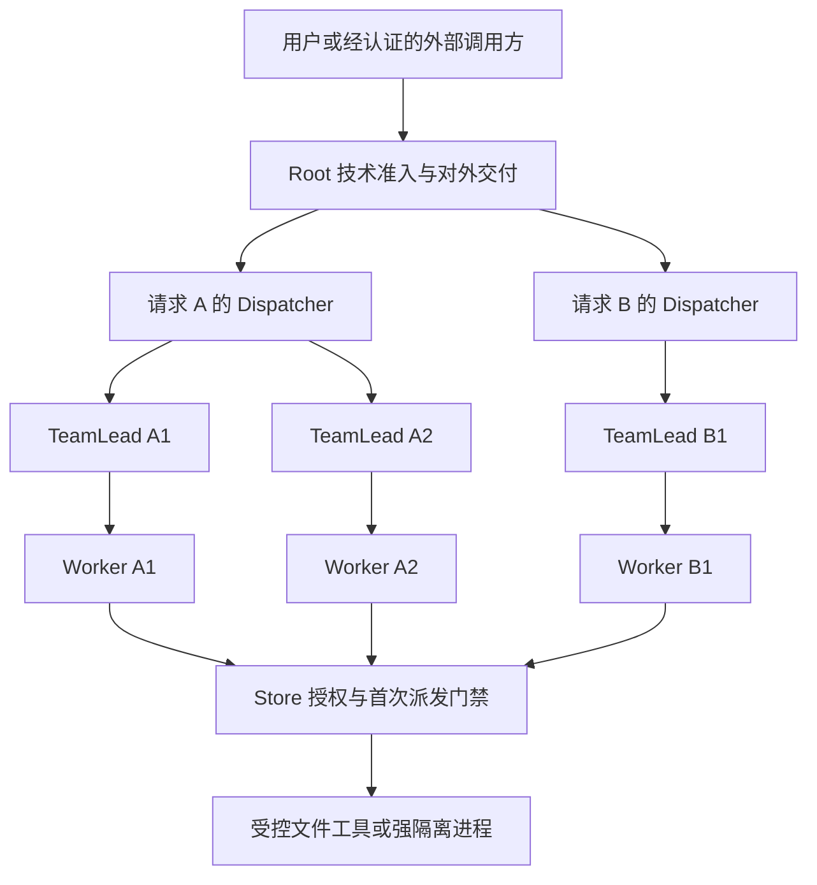

# v0.5.0 架构与现行边界

本章是 **PLANNED / 待审规划**；新能力为 **NOT_IMPLEMENTED / NOT_RUN**。已有模块按下文单独标识，运行版和 Store 版本见[入口](README.md)。原 [v0.4.1 主规格](../v0.4.1/01_实施规格_v0.4.1.md)、[角色规格](../v0.4.1/02_角色行为规格.md)和实施契约继续约束本稿。

## 1. 四层角色保持

图描述逻辑职责。每个独立请求有自己的 Dispatcher；每个团队有一名 TeamLead 和一个有效 Worker。Agent 数量、模型调用数量、线程数量、操作系统进程数量分别计数。运行时、Store、调度器和记忆引擎是宿主组件，不增加第五层 Agent。

| 角色 | 保留职责 | 权限边界 |
| --- | --- | --- |
| Root | 格式/大小/作用域准入、后续消息路由、技术发布与精确回执、受信控制 | 不通过模型过滤接单，不代替 Dispatcher 业务验收，不把宿主核对开放为业务工具 |
| Dispatcher | 计划、逐任务 AMEND、问题处理、当前候选验收、跨功能委派 | 不执行命令；跨功能经对方 Root；不能代签独立审核 |
| TeamLead | 当前 WorkOrder/ChangeOrder、约束传递、原提交检查、有限返工、经验报告 | 不改请求目标或验收标准，不越团队，不把内部检查标作正式独立审核 |
| Worker | 在当前指令和授权下执行、查询、提问、提交与记录证据 | 唯一业务工具执行角色；不能自行生成 Agent、修改权限或认领任意目录 |

各模型和 reasoning 字段直接从请求冻结的 Root 快照取缺省值，不沿中间角色继承。更换模型不能增加工具授权。单 Agent 对照保留四角色权限代理，仅改变经过版本化验证的共享模型历史拓扑，详见 [07](07-product-acceptance.md)。

## 2. 已有基础与新目标分开

| 现有模块及来源 | 已有工程边界 | 后续待实现或待验收 |
| --- | --- | --- |
| [M1](../../implementation/M1-contract.md)、[Scheduler](../../implementation/scheduler-config.md)、[Journal](../../implementation/journal.md) | 合成内核、有界线程池、资源键串行、审核/交接类预留、Linux Journal | 不等于 S1 请求级异步调度、真实审核双容量或 Windows Journal |
| [Store 基础](../../implementation/S1-foundation.md)、[事件](../../implementation/S1-event-runtime.md) | SQLite WAL/FULL、独占写者、短事务、持久 inbox/claim、有限同步事件泵 | 请求 strand、全局公平调度、多进程控制服务及并发写者租约未接入 |
| [工作流](../../implementation/S1-workflow-runtime.md)、[交付](../../implementation/S1-acceptance-delivery.md) | 原问题、原提交字节、TeamLead 检查、Dispatcher 判断、不可变包/回执、经验待办 | 正式跨功能独立审核、DAG、完整私有行清除及真实产品质量仍独立验收 |
| [R1.1–R1.4](../../implementation/R1-management-window.md) | 原历史、structured-v2、冻结 Worker/管理窗口、作用域回读 | LLM 语义摘要、完整记忆引擎和无界历史不在已交付范围 |
| [R3 工作流](../../implementation/R3-live-workflow.md)、[计费](../../implementation/R3-signed-billing.md) | 原预约/唯一发送/传输观察/结算/追加核账，显式宿主授权与本地 TLS 回归 | 真实中转支持、端点能力、实际账单与质量/费用对照尚未验收 |
| [Linux Worker 工具](../../implementation/S1-worker-tools.md)、[分配与清理](../../implementation/S1-owned-cleanup.md) | 描述符固定路径、受控文件工具、仅强模式进程入口、原所有权与库存清理 | 强沙箱部署正向、残留进程接管、Windows 原生实现须各自证明 |
| [运行资源](../../implementation/runtime-resources-and-migrations.md) | 编译认可 SQL/Schema/提示词、迁移注册和安装资源身份 | Windows 资源发现/安装和跨平台格式需明确兼容设计 |

本稿以这些稳定边界为接入点。模块整理由安全边界、重复实现和验证需求驱动，不按文件行数重写 Store，不因出现 `platform/common` 等目录名称就宣布抽象完成。

## 3. 状态权威与执行顺序

Store 是受信宿主 API 的事务权威；模型输出、Schema、提示词、工具定义和协议响应都不能直接授予执行权。每次模型调用先捕获原角色、请求/任务/团队、需求/计划/任务/说明版本、代次、政策、配置与目标 CAS。网络、模型等待和文件/进程效果不在数据库事务中等待。

既有 live 顺序是：捕获当前目标 → 原事务预约与预算预留 → 原事务授予唯一发送权 → 事务外传输 → 保存原观察 → 原始结算 → 受信追加核账 → 按原捕获目标及当前 Store 守卫应用。最后一步仍可能因 AMEND、取消、恢复、政策撤销或 CAS 失效而拒绝；已支付或已结算不使响应重新获得业务资格。

业务工具同样先持久意图，再领取唯一首次派发权；精确重放只返回原事实。所有 workspace/external 非幂等副作用均保留 UNKNOWN 语义。取消请求、进程停止请求、实际退出、结算和清理是不同事实，不能由其中一个推导其余完成。

原始请求/AMEND、调用信封、响应、反馈、原 usage/null、原结算、工单、提交、恢复见证和所有权证据保持不可变。可更新的状态投影使用独立 CAS；不能给迟到响应换上当前版本。新增格式使用显式版本及新迁移方案，不编辑已发布 SQL 或向旧快照补默认字段。

## 4. R2.4 的承接方式

R2.4 已在专用分支实现，正式 PR 尚待审核。依据 [ADR-091](../../adr/091-demand-driven-request-recovery.md)与[实现契约](../../implementation/R2-demand-driven-recovery.md)：`OneRequest` 在原写者事务内判断当前是否需要恢复；空闲重开可保持 epoch。未完操作、PENDING 调用、活动领取、需要重新围栏的收尾状态等仍走必要恢复。`AllRequests` 和显式恢复保持强制语义。

空闲 epoch 不变不等于旧 Actor 可复用。每个新 Store 执行会话独立签发 Actor，身份校验先于精确重放；临时会话身份不写入原持久 actor 指纹。R2.4 的会话隔离也用于 WorkerTools 的结算失败围栏，同一会话重建工具对象不能清除它。数据库级独占写者保持原样，按需恢复没有实现按请求并发写者租约。

原清理领取仍校验当前会话、epoch、claim、作业 CAS 和 manifest；恢复、Root 结果核对、进程重启均不能替代原进程退出证据。终态只开放已经捕获的受限经验/账目/清理控制，不重新开放普通业务。

## 5. S3 多层自动记忆

完整 MemoryEngine 为 **PLANNED / NOT_IMPLEMENTED / NOT_RUN**，承接[原记忆规格](../v0.4.1/03_记忆系统v1规格.md)。已有上下文窗口和经验报告属于输入与来源基础，不是完整记忆系统。

拟按五种触发层协作：确定性加载适用规则；任务/团队/说明变化时提供有限卡片；按需 recall/load；错误签名触发失败经验；验收后由原经验作业生成 new/revise/conflict/no_new_experience。自动触发不等于自动授权或扩大可见范围。

内容保持 rule/fact/experience/skill 四类与 draft/active/archived/blocked 四态；project/function/global 可见范围独立于这些类别。每次实质内容或脚本变化形成不可变 revision，使用绑定 `memory_id + revision + load_id`，反馈按 revision/source_key 去重，修订使用 `expected_base_revision` CAS。不同条件的方法允许并存，新版本不继承旧版本分数。

Git 内容、SQLite 发布/撤销/反馈和检索索引使用可恢复协议连接；不能声称一个跨存储原子事务。规则、脚本、扩大作用域、第三方导入和合并按明确政策独立审批；`reindex` 不授予权限。撤销先进入派发门禁再通知实例；在途副作用仍核对，删脚本不证明旧进程停止。检索先做授权/状态/条件过滤再排序和 limit，标题、片段和数量也受保护。

## 6. S4/S5 接入边界

MCP Client 调外部工具与 MCP Server 被调用均复用 Root/Store 原入口，分别定义认证、能力清单、版本、取消、回执和预算。工具能力组合只能缩小已获准的工具集合，不能让管理角色借 MCP 执行业务命令。第二模型适配器须独立证明原生工具往返、reasoning、usage、缓存与协议差异，不能因为同名字段而静默映射。

A2A、daemon/API、语义检索、跨平台产品化与高级治理归入 S5 主线。服务化先定义外部身份到宿主 Actor 的发行边界，不能直接暴露 Store 参数；跨进程消息不会替代事务授权。语义检索只改变合法候选排序，不改变可见性、版本或发布权。Windows 前置工作可在 S1–S4 并行推进，完整支持由[原生验收](04-windows-native.md)决定。

## 7. 架构证据的限制

结构查询使用 `mnt-d-codex-workspace-wls861-r2-4-20261029-feature` 的 fast 图谱，generation 为 `2026-10-30T02:07:47Z`，并核对对应源码。图谱对部分 C++ 声明及 `.inc` 存在解析缺口，不能据缺失调用边推断接口未实现；例如 live/cleanup 的 Store 子文件须直接源码复核。模块表来自完整实施契约、公开接口及定点源码，不是全调用图完备性证明。正式实现仍按 [05](05-security-acceptance.md)和 [09](09-release-governance.md)提供独立验证。
