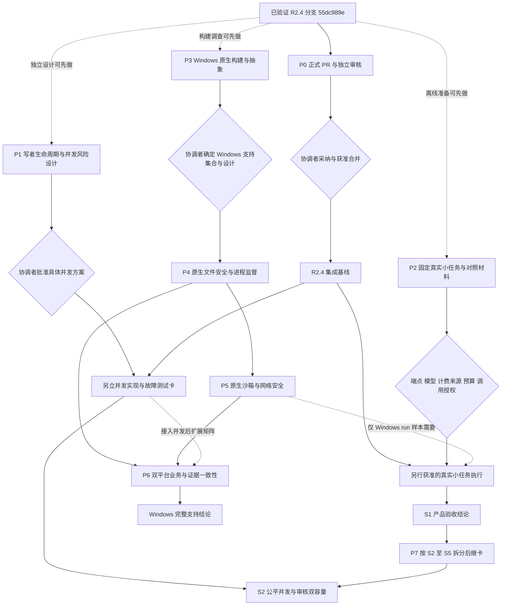
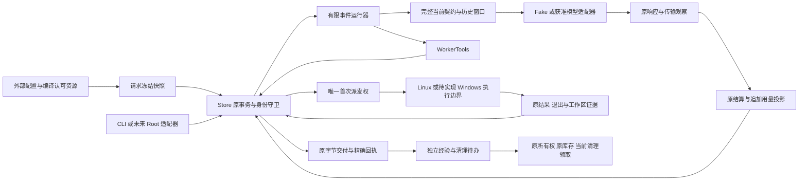
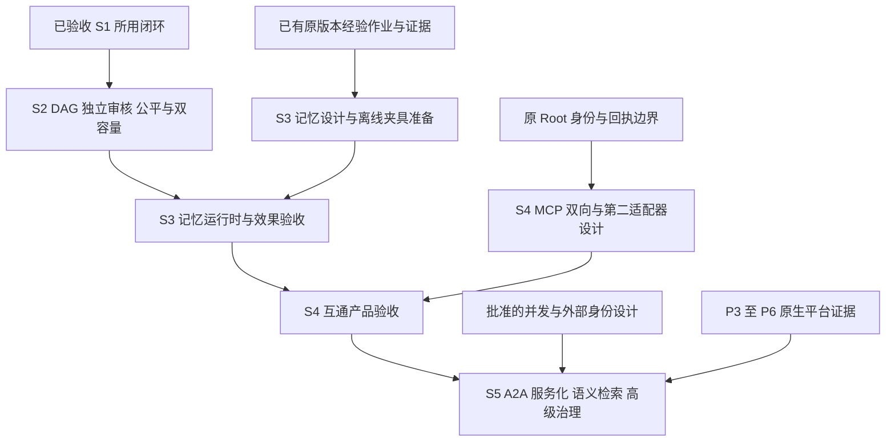

# v0.5.0 模块依赖与批准门禁

以下为 **PLANNED / 待审依赖图**，新增实现/验收为 **NOT_IMPLEMENTED / NOT_RUN**。实线表示必需技术依赖，虚线表示可先做的准备或条件性依赖；菱形表示需绑定具体方案的批准。图中的批准不是本稿已作出的决定。

## 1. 近期任务依赖

P0 本轮只创建/完善正式 PR 和交接，不执行合并。P1 是风险设计卡，批准后仍需独立实现卡；其未完成不阻塞 P2 的离线材料或 P3 的构建调查。真实执行根据所用平台/工具补齐安全证据；Linux 文件任务不等待 Windows 沙箱，任何平台的 `run` 都不能借图中虚线省掉自身强隔离条件。

## 2. 运行模块的接入方向

图示业务数据流，不表示所有调用是同步或一个跨存储事务。未来调度、MCP、A2A 和服务入口只能接入原权威边界；原副作用结算失败仍保留 UNKNOWN 和执行围栏。

## 3. 源码接入点与责任

下表是后续任务的影响范围，不是本轮修改清单；新增 API 名称和文件布局在实施卡中确定。

| 模块 | 当前源码/契约入口 | 新工作依赖与不得破坏的边界 |
| --- | --- | --- |
| 事务/恢复/租约 | `src/store.cpp`、`src/store_*.inc`、`include/wls/store.hpp` | P1 先审连接、锁、事务与 Actor 生命周期；保留原快照、CAS、scope、会话、epoch、SQL 与账目 |
| 事件/角色/公平 | `src/event_runtime.cpp`、`src/offline_runtime.cpp`、`src/scheduler.cpp` | 原 inbox/claim 与捕获目标；整合 S2 双容量和取消，不将 M1 回调配额直接称为 Agent 生命周期配额 |
| 配置/上下文/记忆 | `src/config_loader.cpp`、`src/context.cpp`、`src/structured_*`、`src/worker_history.cpp`、`src/management_context.cpp` | 请求冻结、原完整历史、版本化回读；S3 新 MemoryEngine 不由现有 Schema/经验表自动得到 |
| 模型/费用/对照 | `src/provider_profile.cpp`、`src/protocol_codec.cpp`、`src/sse_replay.cpp`、`src/https_transport.cpp`、`src/live_model.cpp`、`src/billing.cpp`、`src/single_agent.cpp` | P2 复用原链；S4 增第二适配器需冻结能力与计费语义；不改原 unknown/null 或历史 v1/v2/v3 身份 |
| 文件/进程/清理 | `src/workspace_posix.cpp`、`src/sandbox_posix.cpp`、`src/process_evidence.cpp`、`src/cleanup_posix.cpp`、`src/cleanup_runtime.cpp`、`src/worker_tools.cpp` | P3–P6 设计真正平台边界；对象身份、授权、退出和清理权分别验证 |
| 交付/持久/资源 | `src/delivery.cpp`、`src/journal_posix.cpp`、`src/runtime_resources.cpp`、`src/migrations.cpp`、`cmake/runtime_resources.cmake` | Windows 原生锁/同步/安装/发现；保持 Journal 与 SQL 原格式，平台证据另行版本化 |
| 构建/验收 | `CMakeLists.txt`、`Makefile`、`.github/workflows/ci.yml`、`tests/`、`scripts/evaluate_r3.py` | 新增 Windows 原生检查；Linux 六路与源码快照继续；固定期限和安全断言不降低 |

现有 `Workspace::dup_root_fd()` 和 `ProcessRunner(int, ...)` 直接体现 Linux 描述符边界，CMake 当前明确拒绝非 Linux。P3 需要先设计可承载平台资源身份的受信接口；将 HANDLE 强转为 int 或删除 CMake 拒绝条件不能完成适配。Linux `device/inode`、Windows 卷/文件 ID、进程退出信号的原含义不能互相伪造。

## 4. S2–S5 的设计依赖

阶段完成顺序不禁止提前设计、协议调查和离线夹具。服务化需要身份发行、跨进程控制、单写者协调和迁移维护等专项；不能仅把 CLI 放到 HTTP handler 中就开放给远程调用方。记忆与互通的上线政策、真实模型支出和最终发布都按 [09](09-release-governance.md)留批准与证据记录。
