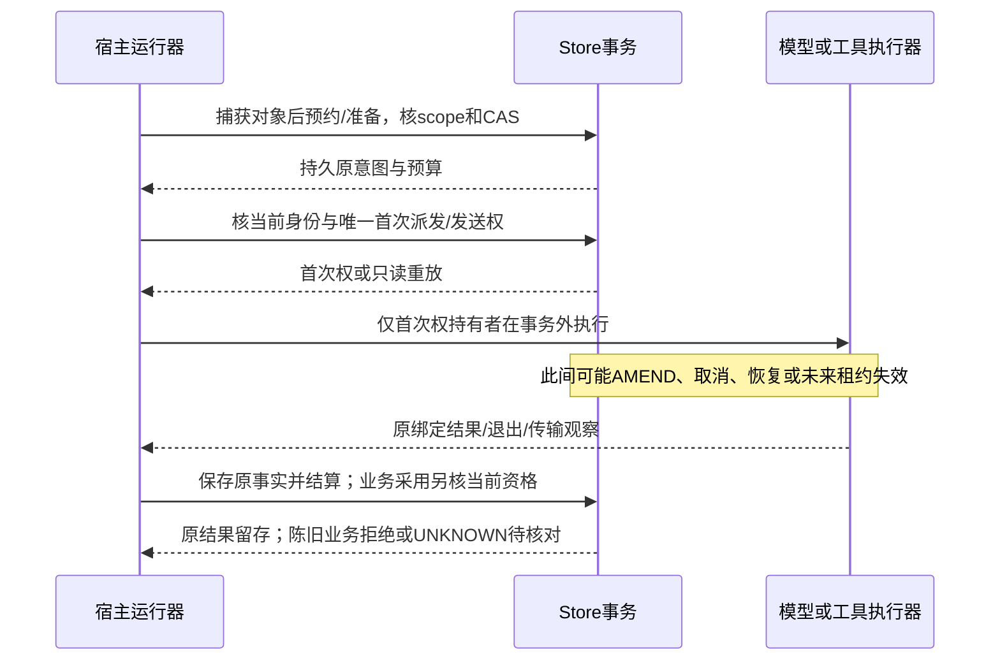

# v0.5.0 并发、调度与写者设计

状态：**PLANNED / 待审**。新增并发写者租约、S1 全局公平调度和审核双容量整合为 **NOT_IMPLEMENTED / NOT_RUN**。P1 先产出设计与风险反例；本章不授权删除现有写锁或启动多写者生产实现。

## 1. 六个不同层次

| 层次 | 当前基础与边界 | 后续目标 |
| --- | --- | --- |
| SQLite 数据库写入 | 一个进程持独占写者锁，写事务串行；WAL 可支持读写并行但不是多写事务同时提交 | 明确连接/进程所有权、短事务与忙等待；如改变宿主写者模型，先批准 P1 设计 |
| 多 Agent | 多个逻辑角色/团队已有持久身份及有界调用 | 模型等待和工具运行可并发，提交仍经原事务；Agent 不等于线程/进程 |
| 多请求 | 每请求独立 Dispatcher、冻结配置和恢复作用域 | 请求公平、故障与预算隔离；不能因接管 A 改 B 的业务状态 |
| 多团队 | 同请求已有独立任务和工作区，DAG 尚待接入 | 独立资源可推进，同资源有序；父子等待不占死执行名额 |
| 调度公平与审核容量 | M1 Scheduler 有合成回调公平/预留；S1 事件泵为有限同步运行 | 按请求/团队/类别定义公平，常态同时保留审核 Dispatcher 与 Worker 容量 |
| 取消与恢复 | 有同进程控制、原 claim/UNKNOWN/epoch；CLI writer 生命周期跨调用 | 取消可达、在途结算与恢复序列明确；跨进程控制单独设计，不用第二写者绕过现有锁 |

R2.4 的 `OneRequest` 按需恢复不等于按请求写者租约。空闲请求可以不递增 epoch，Store 会话仍变更并拒绝旧 Actor；原 `AllRequests`/显式恢复仍强制。恢复范围、宿主会话、业务 epoch、事件 claim、清理 claim 与数据库锁分别有用途，不把它们合成一个“租约 ID”。

## 2. P1 必须先完成的设计内容

### SQLite 与锁生命周期

记录当前 Store 构造/析构、主库/锁/WAL/SHM 的固定身份、同进程多实例、fork/继承、异常展开和崩溃后的行为。保持继承描述符的子对象销毁不解父锁、读快照内账本重建、显式迁移及 AllRequests 维护边界。Windows 另核真实 Handle/共享模式/字节范围锁与 VFS 行为。

设计需覆盖连接线程模型、`BEGIN IMMEDIATE` 起止、回滚/提交失败、busy 处理、读事务与 checkpoint、文件替换/别名、缓存失效及维护排他。`busy_timeout` 只等待锁，不提供业务公平或所有权；`data_version` 可触发缓存失效，不能成为授权或 fencing token。网络/模型/工具等待不得置于写事务或全局状态锁内。

### 候选协调方案

| 候选 | 可实现的并发 | 核心待证明事项 |
| --- | --- | --- |
| A：一个宿主协调写者，异步执行与有界命令队列 | 多请求/多模型/多工具在事务外并发，所有持久变更由一个受控写者提交 | 控制队列可达、公平/背压、捕获版本不刷新、崩溃恢复、写者进程不可用时的退出/保留 |
| B：多个受信连接或进程，共享数据库与明确请求所有权 | SQLite 仍一次一个写事务，宿主逻辑请求可独立推进 | 取消数据库生命周期锁后的全局互斥替代、跨进程 fencing、全库政策/预算/资源/迁移竞争 |
| C：请求分片或更换存储 | 未来更大范围的隔离 | 跨请求账单唯一归属、共享目录、事务一致性及迁移；当前不默认选择，也不纳入最小修复 |

P1 应对至少 A/B 给出证据化取舍；“并行性能更好”不能替代安全证明。先测量等待发生在模型、文件、上下文还是事务，避免把优化推测当作更换写者模型的依据。没有批准方案前保留原独占写者；P1 不阻塞 P2 离线任务准备或 P3 构建调查。

### 仅在选择租约方案时定义的协议

设计须明确 owner/session 身份、request scope、单调 fencing token、CAS、取得/续期/释放/接管、存储权威、时钟来源、失效与恢复状态机。过期时间本身不是权限：停顿的旧进程可能仍存活，墙钟可跳变，进程内单调时钟也不能直接作为跨重启持久期限。

所有会修改当前状态或开始新副作用的边界，必须在同一提交/首次派发事务内检查有效 owner 与 fencing。仅在 CLI 或请求入口检查一次会产生 TOCTOU。一个请求的所有权不覆盖共享账单来源、全局政策、全库结构升级或跨请求目录，因此这些对象还需自己的串行化设计和锁顺序。

租约过期、网络中断、取消、被暂停或宿主崩溃不能证明旧副作用未发生。已经取得派发/发送权的工作不能自动重领；原观察缺失则保留 UNKNOWN 和预算预留，原进程未证实退出则保留资源。旧执行者可能在新所有者接管时完成原效果，系统须区分“保存原事实/结算”与“获得新业务权”，不能为收迟到证据恢复旧 Actor 权限。

## 3. 事务与执行边界

该图承接已有事务原则，不宣称跨数据库/文件/网络 exactly-once。Store 阻止新的陈旧派发，无法撤销已经在事务外发生的效果。测试须观察首次领取数、实际效果数、迟到事实、预算与原记录，不仅检查异常类型。

## 4. S2 公平、背压和审核双容量

定义三种数量：持久逻辑身份、已准入未完成工作、当前占用执行/模型槽位。等待用户、依赖、审核或 I/O 时可保留逻辑任务，但应释放不再使用的活跃槽位；恢复唤醒重新申请。原等待、AMEND、说明应用与 UNKNOWN 门禁仍成立。

蓝图起步配置为 Dispatcher 4 / Worker 8，各常态保留审核名额 1 / 1。若沿用这些值，普通准入最大只能使用 3 / 7，而非等审核到来后才临时抢占。端点模型并发、工具进程数、队列容量与存储/结算预留是独立维度；取得审核 Dispatcher 不代表已经取得审核 Worker 或供应商预算。具体默认值与调优应由冻结配置和性能证据决定，不改旧请求。

拟定义有界按请求轮转/权重、请求内团队轮转和审核/普通/收尾类别配额。评审需明确可运行任务的公平保证、同资源 FIFO、最大连续选择次数、饥饿指标、取消优先级、失败退避和背压出口。不能对永久阻塞、持有同资源的长操作或不可中断宿主 callback 许诺硬实时延迟。

审核应由固定候选触发，生产方等待时释放可释放的槽位与非必要资源锁；不得同步占满同一个线程池等待其子任务。正式票据同时固定 producer 和 reviewer 的完整版本/epoch，审核方恢复后的旧结论拒绝。审核 changes_requested 不改变冻结返工额度，inconclusive/耗尽有明确上报出口。

## 5. 必须计划的并发反例

| 场景 | 验收观察 | 当前状态 |
| --- | --- | --- |
| 两个写者/两个恢复者同时接管同请求 | 唯一当前所有者；原事务串行；无双重派发、错误释放或丢事件 | 原独占写者/R2.4有回归；新租约版本 NOT_RUN |
| 旧持有者停顿超过期限后复活 | 无新预约/派发/清理权；原迟到事实按受限路径留存 | PLANNED / NOT_RUN |
| 续期/释放与接管、写入、claim交错 | CAS及token有单一胜者；失败事务不改变owner或原claim | PLANNED / NOT_RUN |
| 派发已提交后崩溃，结果未持久化 | 实际副作用只发生原一次；恢复UNKNOWN；不以空结果重做 | 已有工具/live原则；新并发组合 NOT_RUN |
| 恢复与清理、退出证据或账目更新交错 | 旧清理权拒绝；原库存不扩展；无退出/结算不删 | 已有R2.4/cleanup原则；新租约组合 NOT_RUN |
| 普通Dispatcher和Worker分别满载 | 审核两类预留都可使用；等待释放；无父子互等 | M1合成基础已有；S1/S2集成 NOT_RUN |
| 一个请求持续繁忙、另一请求可运行 | 有界公平、预算和目录不串；饥饿和控制延迟可观测 | PLANNED / NOT_RUN |
| 多连接读账本期间结算/核账提交 | 单快照重建一致，原证据完整；无跨快照伪损坏 | 已有账本基础；新连接拓扑 NOT_RUN |

使用确定性交错屏障、临时数据库/目录、FakeModel、本地服务和可控进程中断。TTL/时钟测试需可解释的受信时钟边界；不得以生产关闭 fencing 或允许过期重放来构造“成功”。P1 先交设计、状态机、反例及风险处置，获准后才实施并跑 [05](05-security-acceptance.md)的完整门禁。
