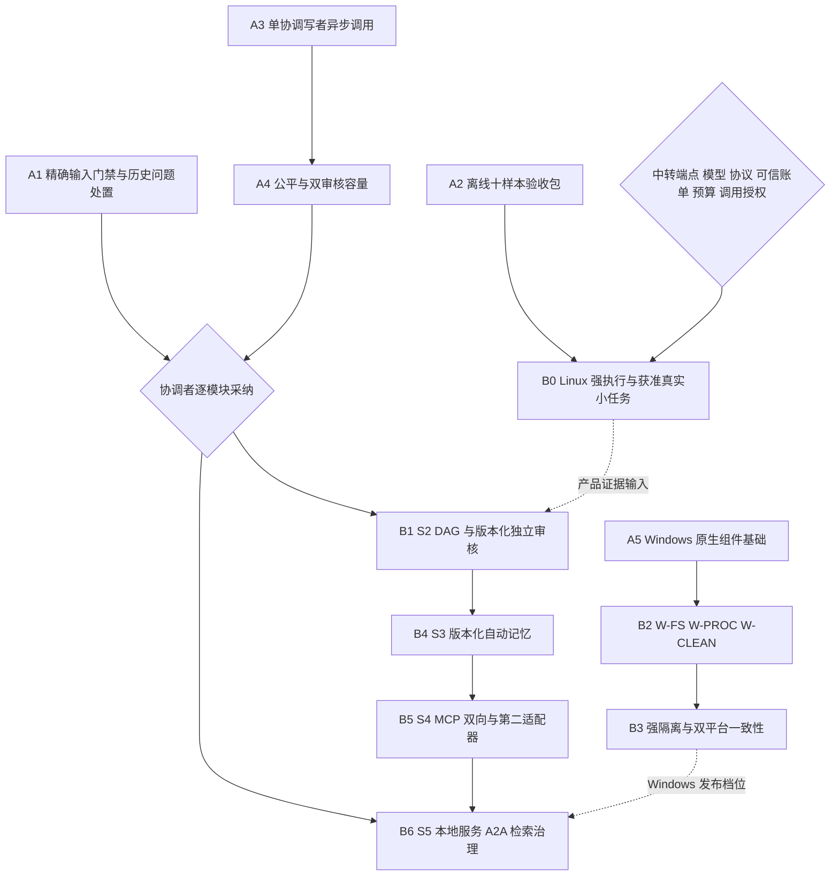

# v0.5.0：获准 A0–A5 批次与 B0–B6 后继依赖

本页记录 2026-10-31 主协调者派发的具体任务边界，补充原 P0–P7 规划。它不升级运行版本或 Store 410，不宣告 S1–S5 完成，不替代最终 SHA 的验收报告。原 v0.4.1、SQL、历史报告和原始证据保持不变。

## 本批已经获得的实施授权

A0 安全接手；A1 本机 GCC 全量复验、历史 Clang/live_workflow 诊断与失败即时输出；A2 复用原 v3 十样本位的可执行离线包；A3 单权威 Store 写者的事务外异步 FakeModel 调用；A4 接入原 M1 的请求/团队公平与双审核容量；A5 原生 Windows 真实模块切片。具体实现入口及实际状态见本轮执行索引和各模块实现契约。代码存在、工具自检、一个平台的 CI、协调者正式采纳和合并分别记录。

协调者已经为本批选择并发章方案 A：一个宿主协调写者、有界队列、事务外等待。多进程多写者租约没有获准实施。A3/A4 可在独立实验分支推进，但历史运行时问题未闭环时不得宣称正式集成验收或合并通过。现有同步 CLI 默认行为及 Root → Dispatcher → TeamLead → Worker 权限保持。

A2 保持原五任务 × multi/single 两条件、原分母和 v1/v2/v3 解释；真实质量/费用仍是 NOT_RUN。A5 的独立 `wls-native-foundation` 直接编译原配置和调度模块，只提供配置/算法/公共资源/能力诊断。它没有 Windows Store、业务文件工具或沙箱。Windows Server CI 与 Windows 11 x64、普通非提升用户、NTFS 实机门禁分别登记。

## 后继依赖

Linux 文件任务不等待 Windows 全面移植；Windows 前置不等待 S5。任何平台的任意不可信 `run` 必须先有本平台强隔离、取消和真实退出证据。以下卡片仅维护目标、接口和门禁，**不由本页自动启动生产实现**。

## B0：Linux 强执行环境与获准 S1 真实验收

- **目标与依赖：** 在隔离环境用合成 canary 验证 bwrap/cgroup、文件/网络隔离、子树取消、实际退出与 owned cleanup；之后使用 A2 原十样本位开展另行获准的真实任务。
- **模块：** `sandbox_posix`、`process_evidence`、`worker_tools`、`cleanup_runtime`、R3 live/billing/single-agent 及离线包配置。只用文件工具的样本与需要强沙箱的 run 样本分列。
- **约束与反例：** doctor 观察不代替运行；缺能力拒绝；合成秘密/网络 canary、仍存活后代、UNKNOWN 或账目未决时提前清理、无授权发送、错误或迟到账单必须有负例。不得改宿主全局策略以制造通过。
- **退出与矩阵：** 普通用户的允许/拒绝及退出/清理证据；同模型、材料、权限、预算和返工限制的十个真实样本，全部失败/取消/UNKNOWN/未执行仍在分母。结构校验与人审质量、耗时、费用分开，不由单样本推断优势。
- **风险与授权：** 中转能力/计费来源不可信、对照条件漂移或将估计记成账单。强环境离线测试不需要供应商/付费；真实执行需要精确中转端点、模型 ID、协议、计费来源、凭据引用、预算、费用责任方和明确调用授权。缺任一项不发试调用，不回退官方直连。

## B1：S2 DAG 与版本化独立审核

- **目标与依赖：** 在获准的 A3/A4 接口上实现持久 DAG 和真实审核闭环；A4 的 Review 容量类别不等于业务独立审核运行器。
- **模块：** Store/事件运行器、TaskEngine、Scheduler、捕获上下文、候选验收与有限返工。新增状态/接口先固定版本和兼容性，不能直接把内存 DAG 当持久权威。
- **约束与反例：** DAG 无环、版本固定、就绪/失败传播、AMEND、取消、恢复；审核票据绑定成果 hash 与 producer/reviewer 双方任务版本、epoch，拒绝生产者代签、旧票据验新成果和恢复后的旧 claim。inconclusive/返工耗尽必须升级。
- **退出与矩阵：** 真实 Store/事件链多节点、两池满载审核、跨请求公平、取消/恢复/旧票据负例，原账目和历史完整；完整 Linux 门禁及实际触及平台门禁。
- **风险与授权：** 依赖环、同池父子互等、审核与生产身份混同。实现/离线矩阵不需真实供应商或付费；具体生产卡与最终采纳由协调者派发和审核，模型质量验收仍另需 B0 调用授权。

## B2：Windows 文件、Store 边界与进程监督

- **目标与依赖：** 依赖 A5 原生基础，拆分 W-FS、W-PROC、W-CLEAN；目标平台首先是 Windows 11 x64、普通非提升用户、本机 NTFS。
- **模块：** Windows workspace/journal/Store 安全打开、原生锁/SQLite VFS、进程监督、交付与 owned cleanup；保持 Linux 对应实现。
- **约束与反例：** 根 Handle、卷/文件身份、SID/ACL、父目录替换权、Reparse Point、ADS/设备/UNC/大小写/硬链接、句柄继承白名单均须实际验证。显式 executable/argv/env/cwd、受控启动和子树监督；Job 终止返回不证明全树退出。
- **退出与矩阵：** 普通用户文件允许/拒绝、并发替换/锁/崩溃恢复、固定受控测试进程取消与真实退出、旧清理 CAS/未知账目/原所有权负例。Windows 事实版本化，不伪造 Linux inode/signal，不接管旧平台活动工作区；确需 SQL 迁移时另立兼容/回滚设计。
- **风险与授权：** 父 ACL 漏检、VFS/耐久语义差异、PID/Handle 重用。无真实供应商/付费需求；具体子卡由协调者派发。B3 完成前任意不可信 run 持续拒绝，额外宿主权限或安全策略变更另需明确授权。

## B3：Windows 强隔离与双平台一致性

- **目标与依赖：** 依赖 B2，以明确威胁模型组合受限令牌/AppContainer等机制，验证完整支持档位；Job Objects 只承担监督/分组职责。
- **模块：** 原生 sandbox、能力检测、派发门禁、退出证据、清理及跨平台共同夹具。
- **约束与反例：** 合成秘密/文件边界、继承句柄、IPv4/IPv6/DNS/loopback/代理和本机通道、子树逃逸、启动竞态、取消后未退出资源；缺能力拒绝且无无限制回退。
- **退出与矩阵：** 原生普通用户正向和拒绝证据；同一业务逻辑输入比较版本、claim、账目、UNKNOWN、效果数和终态。分别执行支持平台安全/E2E/历史兼容矩阵，不要求 PID、Handle 或数据库物理字节一致，不把文档可读当活动状态可迁移。
- **风险与授权：** 多机制组合后通道变宽、管理员 CI 掩盖普通用户失败。无供应商/付费需求；威胁模型、支持档位及发布结论由协调者批准，宿主全局改动不属于普通开发授权。

## B4：S3 多层自动记忆

- **目标与依赖：** 沿用 v0.4.1 记忆规格与已验收版本/身份边界，先交发布、加载、撤销，再交反馈、经验流水线和开关对照。已有经验表不是完整 MemoryEngine。
- **模块：** Git 正文、SQLite 索引、权限过滤、上下文按需加载、错误触发与经验作业、使用/反馈/修订 CAS。
- **约束与反例：** rule/fact/experience/skill 与 draft/active/archived/blocked 分开；内容、使用、反馈绑定不可变 revision，修订 CAS。检索先权限/状态过滤再排序/limit，撤销进入派发门禁，新版不继承旧评分。覆盖跨 scope、旧反馈、撤销后派发、Git/SQLite 中断，不宣称跨存储天然原子。
- **退出与矩阵：** 可恢复发布/加载/撤销闭环、原版本反馈与有限经验流水线、开关对照和全回归。真实模型质量另设授权样本。
- **风险与授权：** 记忆文本成为权限、跨修订污染、撤销延迟。离线实现无需供应商或付费；扩大记忆发布范围、真实任务和破坏性删除另需明确批准。

## B5：S4 MCP 双向与第二模型适配器

- **目标与依赖：** MCP Client 与 Server 分别验收；第二适配器需真实协议增量，不能仅换模型名。依赖原 Root/Store 权限、取消、预算与回执及获准接口。
- **模块：** MCP 双向协议适配、按岗位/能力可见的 Skill/工具、模型协议/usage/缓存/错误与 billing 接口。
- **约束与反例：** 实施时固定官方协议版本与夹具；外部工具文档不形成系统授权，不自动安装/运行不可信脚本。覆盖参数/文档注入、scope 越权、重复调用/取消回执、工具往返、未知费用与不支持能力拒绝。
- **退出与矩阵：** 各方向实际协议离线重放/受控互通、原 Store 事务链和历史兼容；第二适配器完整工具/usage/缓存/错误证据。真实互通和供应商能力不能用本地声明代填。
- **风险与授权：** 协议升级、权限串通、未知成本被补零。离线夹具无需真实供应商/付费；真实调用只走外部配置的用户中转，供应商、费用、预算与范围另行批准，不能自动直连。

## B6：S5 本地服务、A2A、检索及治理

- **目标与依赖：** 以已验证的单协调写者、外部身份与回执契约设计本地服务；逐项交付鉴权、请求隔离、控制/取消、恢复、A2A、可观测性、备份恢复与发布。
- **模块：** 受控外部身份→Store Actor 签发、本地服务接口、A2A 任务/事件/回执、检索、备份与版本化安装包。
- **约束与反例：** 不直接把 Store 参数暴露为 HTTP 授权；覆盖伪造 Actor、跨请求窜写、旧版本重放、失联结果、备份不一致、检索撤销绕过。私有行清除、保留政策、工作区清理与全局数据删除分别验收。
- **退出与矩阵：** 本地认证/隔离/幂等/故障恢复、安全可观测性、备份回放与支持平台发布门禁；语义检索不改变权限和撤销。公网、真实生产数据和跨平台活动状态迁移均不由本卡默认开放。
- **风险与授权：** 外部身份映射过宽、服务放大权限、恢复缺证据。离线/loopback 开发无需供应商或付费；公网部署、真实凭据、扩大记忆发布、生产操作和破坏性清理另需明确批准。

本轮最终只交回 A0–A5 代码、证据、精确 SHA 与剩余门禁。B0–B6 的启动和验收仍由主协调者按依赖逐卡决定。
